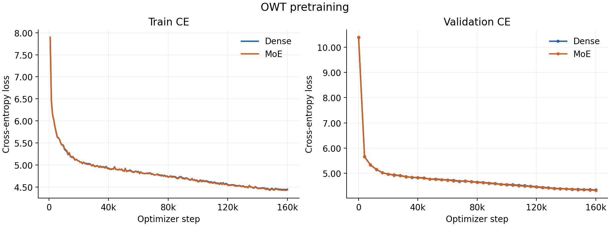
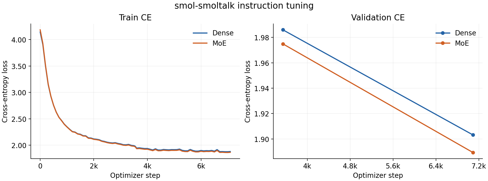
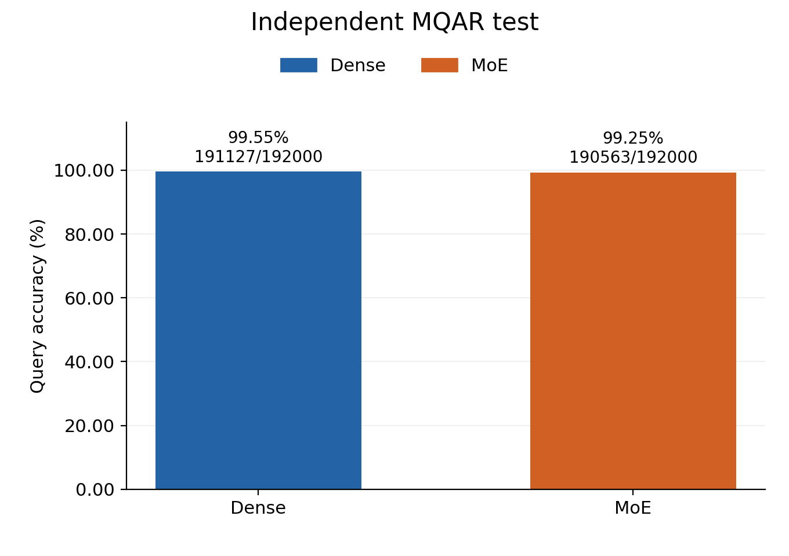
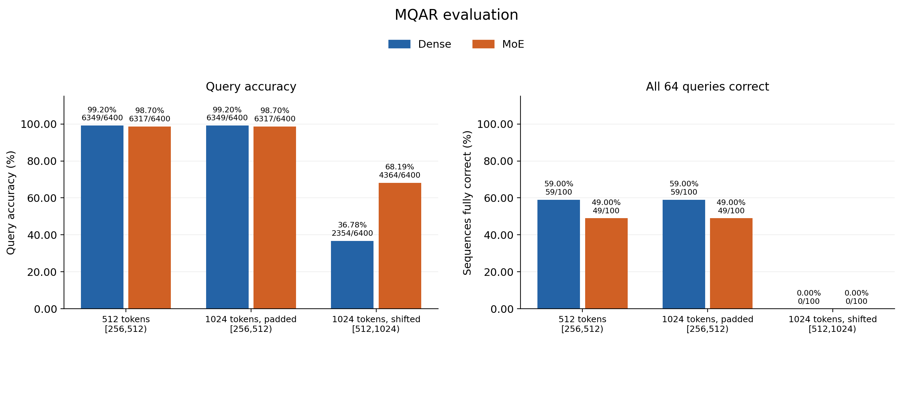
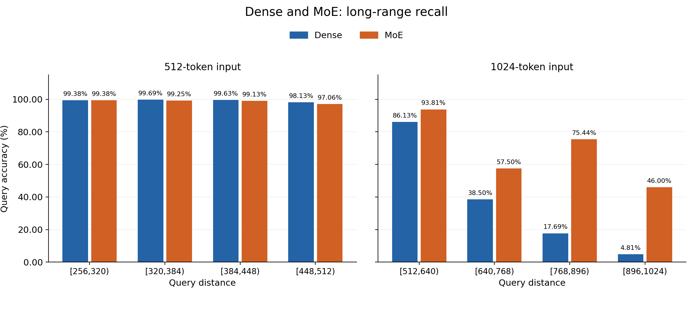

# 面试官你好😊我是Miles Zhu，这是我这两次任务的情况说明，还请你过目了！
# 任务一

## 代码

`1_代码` 保存已有实现，按模块分为以下子文件夹。

| 文件夹 | 内容 |
| --- | --- |
| `tokenizer` | 自写 BPE 训练、编码和解码 |
| `transformer` | Linear、Embedding、RMSNorm、RoPE、Softmax、因果多头注意力、SwiGLU、Transformer block 和语言模型 |
| `moe` | Top-2 路由、专家分发、输出加权、负载均衡损失、MoE Transformer 和 grouped GEMM 实现 |
| `trainingloop` | 训练循环、数据采样、checkpoint 保存和加载 |
| `optimizer` | 自写 AdamW |
| `training_utils` | 自写交叉熵、梯度裁剪和余弦学习率调度 |
| `decoding` | 文本生成代码 |
| `experiments` | OWT、SFT、MQAR 的实际训练入口、数据构造、评估和配置 |

`2_实验和训练数据` 保存 OWT、SFT、MQAR 的配置、训练指标、评估结果和预测。`training_data` 保存实际使用的 OWT token 数组、BPE 词表与 merges、smol-smoltalk 训练与验证数据、MQAR 训练与验证及测试数据。[训练数据下载](https://github.com/LitzGymrat/N1-AI-school-technical-tasks/releases/tag/training-data-v1)。

## 第一部分：OWT 预训练与 smol-smoltalk 指令微调

### OWT 预训练

Dense 和 MoE 均从随机初始化开始，在同一份 OWT 数据上训练。自然语言数据使用自己训练的 32000 词表 BPE tokenizer。每次从训练 token 流中抽取连续片段，预测下一个 token。

| 参数 | Dense | MoE |
| --- | --- | --- |
| 层数 / hidden size / heads | 6 / 512 / 8 | 6 / 512 / 8 |
| 上下文长度 / 词表大小 | 2048 / 32000 | 2048 / 32000 |
| FFN | SwiGLU，宽度 1344 | 4 个 SwiGLU 专家，每专家宽度 672，Top-2 |
| 总参数量 | 51,452,416 | 63,851,008 |
| Batch size / 梯度累积 | 1 / 1 | 1 / 1 |
| 更新次数 / 累计输入 tokens | 160000 / 327680000 | 160000 / 327680000 |
| 优化器 | 自写 AdamW | 自写 AdamW |
| 峰值 / 最小学习率 | 6.00e-4 / 6.00e-5 | 6.00e-4 / 6.00e-5 |
| Warmup / 后续日程 | 3200 步 / cosine | 3200 步 / cosine |
| AdamW betas / eps / weight decay | (0.90, 0.95) / 1.00e-8 / 0.10 | (0.90, 0.95) / 1.00e-8 / 0.10 |
| 梯度裁剪上限 / 随机种子 | 1.00 / 42 | 1.00 / 42 |
| 计算精度 / 注意力 | BF16 autocast / FA2 | BF16 autocast / FA2 |
| 均衡损失系数 | — | 0.01 |
| GPU | RTX 4090 | RTX 4090 |

模型参数和优化器状态保持 FP32。MoE 的训练目标为 `CE + 0.01 × balance_loss`，曲线和下表中的 loss 均为 CE。验证每 4000 步进行一次，使用相同的固定 32 条、每条 2048 tokens 的 OWT 验证片段。

| 最终结果 | Dense | MoE |
| --- | ---: | ---: |
| Train loss | 4.45 | 4.43 |
| Valid loss | 4.34 | 4.32 |

Train loss 为最后一个 800 步记录窗口的平均值。MoE 的最终 train loss 低 0.02，valid loss 低 0.02。



### smol-smoltalk 指令微调

Dense 和 MoE 分别加载各自 OWT 第 160000 步的权重，模型和 tokenizer 沿用预训练配置，重新建立优化器与学习率日程。

数据来自 `HuggingFaceTB/smol-smoltalk`，revision 为 `f73fe857d519ff6ac5af2ea67c4d3834da7b8bcc`。保留完整编码长度小于 2048 的对话，再以 seed=42 从 453783 条合格训练样本中均匀无放回抽取一半，即 226891 条；23897 条合格验证样本全部保留。两种模型使用相同的数据和逐轮洗牌顺序。

保留完整多轮对话，每条对话独立组批，按 batch 内最长样本右侧补齐。所有 assistant 回答及其 EOS 参与监督，system、user、角色标记和 padding 不参与 loss。标签只进行一次 next-token 对齐。

| 参数 | 两种模型共用设置 |
| --- | --- |
| 最大完整序列长度 | 小于 2048 |
| 训练 / 验证样本 | 226891 / 23897 |
| 每轮完整序列 tokens / 回答监督 tokens | 188627514 / 152507457 |
| Batch size / 梯度累积 | 64 / 1，保留每轮最后 11 条 |
| Epochs / 每轮更新 / 总更新 | 2 / 3546 / 7092 |
| 优化器 | 自写 AdamW，重新初始化状态 |
| 峰值 / 最小学习率 | 1.00e-4 / 1.00e-5 |
| Warmup / 后续日程 | 710 步 / cosine |
| AdamW betas / eps / weight decay | (0.90, 0.95) / 1.00e-8 / 0.10 |
| 梯度裁剪上限 / 随机种子 | 1.00 / 42 |
| 计算精度 / 注意力 | BF16 autocast / FA2；参数、优化器状态和 CE 为 FP32 |
| 验证与 checkpoint 选择 | 每轮结束验证，以全部验证回答 tokens 的平均 CE 选择 best checkpoint |
| GPU | 每个模型使用一张 A800 80GB，两张卡并行训练 |

MoE 保留 4 专家、Top-2、grouped GEMM 后端和 0.01 均衡损失系数。

| 结果 | Dense | MoE |
| --- | ---: | ---: |
| 第 1 轮 valid loss | 1.99 | 1.97 |
| 第 2 轮 valid loss | 1.90 | 1.89 |
| 最后记录窗口 train loss | 1.88 | 1.86 |

MoE 的最终 train loss 低 0.01，valid loss 低 0.01。曲线直接使用原始记录，验证曲线只有两轮结束时的两个点。



## 第二部分：专门训练模型利用 long-range information

### 目标与任务构造

我们希望构造一个任务来检测模型是否在训练中学会了利用long-range information


一开始我调研了一些相关工作找到了一些任务比如说变量追踪，多跳问答，高频词聚合这一些，

但是这一些都需要比较强的指令遵循能力：
我用我在第一部分里面训练出来的模型发现它首先经过OWT训练就没办法正常吐字，容易出现重复，或者说乱码


比如经典的：Where is the capital of France? The capital of France is France.


我研究了一下，跟一个性能还行的小模型：SmolLM2-135M相比，预训练的token量差距太大了，

| 项目 | SmolLM2-135M | 我们的 Dense |
| --- | --- | --- |
| 总参数 | 134.50M | 51.50M |
| Transformer 主体参数 | 106.20M | 18.70M |
| 层数 | 30 | 6 |
| 隐藏维度 | 576 | 512 |
| embedding 与输出层 | 共享 | 独立 |
| 预训练 token | 2 万亿 | 3.28 亿 |

我去试了一下64M的经典开源项目Minimind但是发现它也很差，


我就知道应该不是我训练参数或者模型本身的问题，很大问题应该是来自于训练量：
所以在有限的时间和算力之下，他的自然语言任务都表现很差，所以就放弃通过自然语言预训练的模型来完成任务一中测评模型是否在训练过后学会Long-range information利用的问题。


所以我又调研到一个专门做长序列能力的工作Zoology，他就直接从预训练阶段让模型学习符号任务，这样子更加好训练，便于我在资源有限的情况下去尝试测评这个问题。
借用其中用于测试模型长上下文中关系捕获能力的任务构造：
任务形式化：

按[原论文 §3.2，Definition 3.1](https://proceedings.iclr.cc/paper_files/paper/2024/file/448fc91f669c15d10364ee01d512cc10-Paper-Conference.pdf#page=5)，给定输入序列：

```math
x=(x_0,\ldots,x_{N-1})\in\mathcal C^N,\qquad |\mathcal C|=c.
```

对于每个查询位置`i`，在前面找相同的token，输出它后面的token：

```math
1\le i<N,\quad \exists\,0\le j<i:\ x_i=x_j
\quad\Longrightarrow\quad y_i=x_{j+1}.
```

我们这里取`N=512`、`c=8192`、`D=64`，把键值对放在前缀，query放在后面的`q_r`位置：

```math
x_{2r}=k_r,\quad x_{2r+1}=v_r,\quad x_{q_r}=k_r,
\quad y_{q_r}=v_r,\qquad r=0,\ldots,D-1.
```

每条样本重新随机配对，key和value分别无放回采样。query位置按幂律采样（α=0.01），其余位置填0，只在query位置算loss。


训练举例子：

这里用一个缩短的样本举例，每个字母占一个token：

```text
位置： 0 1 2 3 4 5 6 7 8 9 10 11 12 13 14 15
输入： A a B b 0 0 B 0 0 0  0  0  A  0  0  0
标签： · · · · · · b · · ·  ·  ·  a  ·  ·  ·
```

位置6的B要回答b，位置12的A要回答a，`·`表示不算loss。下一条样本如果是`A c`、`B d`，就要回答c和d。


实际测试举例子：

512长度远距离测试集第0条样本，数字是实际符号ID：

| 前面的键值对 | key位置 | query位置 | 距离 | 正确value | Dense回答 | MoE回答 |
| --- | ---: | ---: | ---: | ---: | ---: | ---: |
| 3909 → 7511 | 0 | 510 | 510 | 7511 | 7511 | 7511 |
| 1076 → 5474 | 64 | 446 | 382 | 5474 | 5474 | 5474 |
| 1477 → 7054 | 126 | 432 | 306 | 7054 | 7054 | 7054 |


首先明确我们的核心问题：“测评模型是否在训练过后学会Long-range information利用”


为什么说这个任务可以体现这个点呢？


首先这个任务本身就要求模型捕获位置和逻辑关系去匹配键值对，比如“前面出现A a，后面再出现A的时候要找到a”，
这个可以理解为对于信息的利用，那么我们如果将键值对的距离进行控制，使其相对较长，就成为了一个长距离信息利用的任务，到这里还是很合理的。


所以我们希望模型能够从这个训练中学习到这样的长距离信息利用的能力，而不仅仅是记住。


由于验证集中的长距离键值对匹配是模型没见过的，假如他并没有学会这样的能力，他不可能能够大量的匹配好没见过的组合，我认为这个分布外的能力测试是能够反映其学会了这样的利用。


因此我选择构造这个任务，认为其可以测评模型是否在训练过后学会Long-range information利用。
首先为了清楚说明，我们定义Long-range information为：

```math
d=\text{训练时的 }\mathtt{context\_len}=512,\qquad
\Delta=\text{query位置}-\text{对应key首次出现的位置}.
```

这里把距离Δ≥d/2的信息定义为long-range information。

构造实验：

我们重新从零训练Dense和MoE，train/valid/test分别是100000/3000/3000条，seed分别是0/10/20。

| 参数 | Dense | MoE |
| --- | --- | --- |
| 层数 / hidden size / heads | 2 / 512 / 1 | 2 / 512 / 1 |
| 上下文长度 / 词表大小 | 512 / 8192 | 512 / 8192 |
| 位置编码 / 归一化 | RoPE，theta=10000 / pre-RMSNorm | 同左 |
| FFN | SwiGLU，宽度 1344 | 4 个 SwiGLU 专家，每专家宽度 672，Top-2 |
| Embedding 与输出权重 | 共享 | 共享 |
| Embedding / attention dropout | 0.10 / 0.10 | 0.10 / 0.10 |
| 初始权重标准差 | 0.02；残差输出投影为 0.01 | 同左 |
| Batch size | 128，保留尾 batch=32 | 同左 |
| 优化器 / betas / eps / weight decay | torch AdamW（fused）/ (0.90, 9.99e-1) / 1.00e-8 / 0.10 | 同左 |
| 初始学习率 | 2.15e-3 | 同左 |
| 学习率日程 | 每轮更新 cosine，T_max=64，最小值 0，无 warmup | 同左 |
| 精度 / 注意力 | FP32，关闭 TF32 / efficient SDPA | 同左 |
| 监督 | 仅计算每条样本 64 个 query 的 CE | 同左，另加 0.01 × balance_loss |
| 最大预算 / 停止条件 | 64 轮 / 每轮验证，准确率 >99.00% 时停止 | 同左 |
| 初始化种子 | 123 | 123，共享部分的初始权重与 Dense 相同 |
| 实际训练轮数 / 更新次数 | 20 / 15640 | 16 / 12512 |

1. 512长度内：100条，每条64个query，距离都在`[256,512)`；256、258、……、510这些合法距离各出现50次。
2. 1024长度外推：保持同一批样本的KV和答案不变，把query后移到`Δ∈[512,1024)`；512、514、……、1022这些合法距离各出现25次。另设末尾补0、query位置不动的对照组。模型不再训练，RoPE按原公式扩展缓存，theta不变。

准确率只统计query位置：

```math
\mathrm{Accuracy}=\frac{\text{回答正确的query数}}{\text{全部query数}}.
```


实验结果(各项细粒度也给出，附上图注)：



图注：原始独立test，3000条样本、192000个query；柱上标出准确率和正确数。



图注：每组100条、6400个query；左图是query准确率，右图是整条64个query全对的比例。



图注：左图是512长度，右图是1024长度；横轴是距离区间，纵轴是query准确率，每个区间1600个query。


对于MoE和Dense模型，我们可以看到，经过了一定量的训练


1.对于在训练的context_len之内：
他们在给定的序列之内，面对没见过的符号键值对组合也能够有相当的准确率，这个组合他们并没有见过。

假如他没有在预训练中学会这项能力，我认为其不可能泛化过去。


2.对于从512-1024，超出的context_len。
可以看到我们超出训练的上下文范畴，两个模型在一定范围内，依然能够有一定的查找匹配准确率，其中MoE在[768,896)的准确率是75.44%，在[896,1024)仍有46.00%，整体比Dense高31.41个百分点。

面对超出训练的上下文范畴，他们依然能够在long-range（大于等于d/2甚至大于d）的情况下，去匹配键值也就是利用信息，进一步为其收获了这种利用长距离信息的能力提供了依据

 至此，任务一完成
