# Transformer 在什么条件下能够真正学会利用长距离信息

N1 AI school二面任务技术报告 MilesZhu 2026.10.16

## 1 问题拆解和明确

我们的核心问题是“Transformer在什么条件下能够真正学会利用长距离信息”。这个问题同时涉及模型、任务、数据与训练过程，为了让研究能够在有限的资源内开展，我们首先对问题进行拆解和在本文探究语境下的限定。

我们将核心问题拆解为以下几个部分进行限定：

- Transformer：模型主体架构。
- 条件：包括模型参数，数据与训练过程等。
- 对于“利用长距离信息”进行分析和任务构造。
- 学会：怎么样算是“学会”。

### 1.1 模型

为了在保留现代语言模型常用结构的条件下研究这一问题，我们固定因果Decoder-only Transformer主干，包括Pre-RMSNorm、SwiGLU和残差连接等。[Touvron等（2023）](https://arxiv.org/abs/2302.13971) 保留归一化与非线性前馈计算，在这一模型家族中我们也可以检验关于序列文本中注意力检索的假设。[Olsson等（2022）](https://transformer-circuits.pub/2022/in-context-learning-and-induction-heads/index.html)

### 1.2 条件

分为三类：

**模型条件：**

保持现代语言模型常用的基本架构不变，我们选择层数、宽度、头数和位置编码为探究条件。

其中虽然现代语言模型常用RoPE进行位置编码，但是由于我们认为从直觉上来看，长距离信息任务中位置编码的信息会起到关键的作用，所以我们将其纳入变量条件以探究其影响。

**训练条件：**

除开超参数之外（探究超参数过于Trivial了），主要的影响因素包括：

1. 训练预算。
2. 不同样本训练的顺序（比如说长距离信息依赖训练和短距离信息依赖训练的先后）。

**数据条件：**

主要是数据的分布，比如不同信息依赖长度的覆盖范围和采样频率。

### 1.3 训练目标的定义：“学会利用长距离信息”

首先针对“长距离”：我们分为两种情况：

第一种是在训练上下文长度内利用相对较远的信息；

第二种是在训练完成后，将这种能力拓展至超出训练长度的序列。

**我们认为第一种研究模型如何学会远距依赖，第二种还要求已经学到的计算适应新的长度与位置。** 为了先减少影响因素，缩小研究范围探究机制，本文先研究第一种，再将长度外泛化作为扩展。

设训练上下文长度为 $L$，完成信息利用所需要的距离为 $\Delta$（信息依赖距离），我们将训练上下文内的“长距离”定义为

$$
L/2\leq\Delta<L.
$$

为了覆盖长距离，我们从 $L$ 开始向前覆盖，跟随[Lost in the Middle](https://aclanthology.org/2024.tacl-1.9/)里面关于模型在面对长上下文时性能的U型曲线（对于中间信息呈现性能下滑），我们将 $\Delta$ 覆盖到 $L/2$，认为该距离覆盖能较充分体现长距离信息利用的难度。

我们把“学会利用长距离信息”定义为：模型在经过训练之后，能够在要求距离跨度 $L/2\leq\Delta<L$ 的未见信息利用任务上取得良好表现。

## 2 任务构造

根据这一定义，为了探究不同变量对“学会利用长距离信息”的影响，我们需要构造一个定量、高效，凸显长距离信息利用要求性质的任务。

跟随[Zoology](https://arxiv.org/pdf/2312.04927)构造的多查询关联检索任务：在同一键值序列中设置多个查询，查询和键值对的距离即可以视为利用信息完成关联任务所需要的距离。从而通过控制查询和前文键值对的距离来控制距离变量。

我们的基本形式采取MQAR，例如：

$$
\ldots,\ k,\ v,\ \ldots,\ k\,(q)\ \longrightarrow\ v.
$$

图1：MQAR基本形式，$\Delta=q-s$。问号表示待预测的值。

这里的键 $k$ 用于标识关联，值 $v$ 是要取回的答案，后一次出现的 $k$ 是查询。每条新序列都重新随机配对键和值，因此模型需要利用当前上下文中的关联完成预测。下文将原始键的位置记为 $s$，相邻值的位置为 $s+1$，查询位置为 $q$，依赖距离为 $\Delta=q-s$。

为了让此次面向长距离信息利用的任务更加鲁棒，我们在MQAR基础上采取以下改进：

1. 在信息之间存在的间隔，为了排除固定内容（如字符0）填充可能带来的影响，在不同键值对和查询之间，我们用随机的词元填充。
2. 给训练引入噪音干扰：为了更好测试模型利用信息的能力，设置不被查询的键值对。模型需要在候选键值对中学会选择。

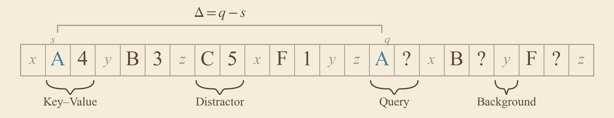

图2：随机背景（灰色小写字母）与不被查询的干扰绑定C–5。问号表示待预测的值。

**基本任务形式化：**

令 $x=(x_0,\ldots,x_{L-1})$ 为长度为 $L$ 的词元序列，键、值和背景分别取自互不重叠的词表 $\mathcal K$、$\mathcal V$ 和 $\mathcal B$。一条序列包含 $n_q$ 个查询关联和 $n_d$ 个干扰关联。对于第 $i$ 个查询关联 $(k_i,v_i)$：

$$
x_{s_i}=k_i,\qquad x_{s_i+1}=v_i,\qquad
x_{q_i}=k_i,\qquad x_{q_i+1}=v_i,\qquad
\Delta_i=q_i-s_i.
$$

所有源键互不重复，值可以重复采样；各关联的位置不重叠。干扰关联只放置相邻的键和值，不安排查询；其余位置从背景词表独立随机采样。模型在 $q_i$ 处根据截至该位置的输入预测 $v_i$，损失为

$$
\mathcal L(\theta)=-\frac{1}{n_q}\sum_{i=1}^{n_q}
\log p_\theta\!\left(v_i\mid x_0,\ldots,x_{q_i}\right).
$$

基于这样的任务构造，我们就可以控制输入长度，信息依赖距离以及训练样本的分布等，进行控制变量的定量探究。

### 2.1 问题的澄清

原问题“能够真正学会”较为含糊，为了使研究目标明确，有的放矢，对问题进行不同情况下细粒度的澄清。

针对“能够真正学会”，我们认为需要区分两种情况：

1. 对于“学会”的必要性：学会长距信息利用所必需的条件，如果没有，模型不能够学会。针对这一点我们提出必要性的假设。
2. 对于“学会”的有利性：有利于模型学习长距信息利用的条件。针对这一点我们提出有利性的假设。

**两者需要不同的证据，也决定了哪些变量值得进一步研究。**

首先需要明确“必要”的含义。如果一个条件是学会任务的必要条件，就意味着去掉它以后，模型无法通过任何方式成功训练。要确证这一命题，就必须排除其他可能成功的训练与学习方式。然而，优化方法、数据安排和训练时长等可以有无穷多种组合。即使某种结构在我们测试的全部运行中都没有学会，也不能据此排除它在另一种训练方式下成功的可能。

比如训练预算，某个模型在给定步数内没有学会，可能是训练量不够，也可能是这个模型架构无法表达任务能力等。二者起初都训练失败，但如果延长训练后模型学会了，就应该解释为更新不够而非架构表达能力不足等。

所以仅凭有限预算的测试，无法确证条件对于“学会”的普遍必要性。

根据任务要求，本文仍然研究必要性假设，通过实验为假说提供支持或反证。

我们先说明某个条件为什么可能不可缺少（提出假设），再设计实验探究。

这样，问题一保留了对模型“长距离信息利用学习的必要条件”的研究目标，同时明确实验能为假说提供的支持。

### 2.2 对于条件的选择

在前文澄清的“必要性”和“有利性”的两个问题的基础之上：

1. 我们认为并非所有看起来成立的必要条件都有研究价值。例如，把预算设为0步或极少的步数，模型通常无法学会任务。由此得出“必须有充足的训练预算”，只是重述学习需要训练，我们认为其研究价值较小。我们不把这类显然的条件（trivial conditions）作为本文的主要假设。
2. 同时，一个条件可以并非必需，却仍然有利于学习。只要比较中的模型都能达到共同准确率，就可以直接检验某个改动是否减少了所需更新数。例如，若两头与四头模型都能达到相同准确率，而四头模型所需更新数更少，就说明增加头数有利于学习，但四个头并不是学会任务的必要条件。在实验中更新速率的改善就可以提供有利于学习的证据。
3. 我们把训练预算作为共同的实验约束，对不同条件假设进行检验。进而在相同的有限训练内分别探究：能使训练目标“达成”和能够使训练目标“更早达成”的影响条件。例如，在共同预算内比较一层与两层单头模型能否学会，是检验目标能否达成；在两种训练顺序都能学会的种子中比较达标步数，则是检验目标能否更早达成。

## 3 问题一：学会长距离信息利用需要的条件探究（必要性假设）

问题一分为模型条件和数据条件两部分。模型部分先检验最小结构，再检查跨层计算及位置信息的作用；数据部分进一步考察长距监督，以及训练分布对读取方式的影响。

**实验设置。** 主实验上下文长度为1024，默认模型为4层、隐藏宽度256、4个注意力头，使用Pre-RMSNorm、SwiGLU与RoPE。结构对照每次改变对应的模型条件；数据对照固定模型，改变长距监督覆盖。每组比较使用共同预算与测试集，并分别保留各训练种子的结果。必要性假设的依据、具体对照与机制检验在各小节说明；完整训练配置见[附录E](附录.md#appendix-e)。

### 一、模型条件

### 3.1 长距检索的最小结构

一个自然的假设是模型需要一个最小结构来学会表达长距离信息利用能力。

跟随归纳头研究中对于Transformer在序列键值匹配任务中的洞察：较早一层的前一词元头（下称“局部关联头”）把键的信息带到相邻值的位置，较晚一层的归纳头（下称“检索头”）根据查询匹配这些信息，再读出值。这样，值的位置既保留答案，也包含“这个答案属于哪个键”的信息。[Olsson等（2022）](https://transformer-circuits.pub/2022/in-context-learning-and-induction-heads/index.html)分析了这一跨层组合，并通过直接提供前一词元信息的结构改动检验其作用。

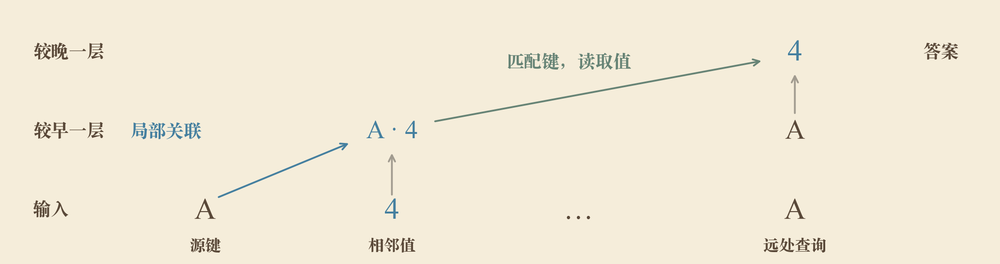

图3：归纳回路的两步计算：较早一层把键A的信息带到值4的位置，较晚一层根据查询A读取值4。箭头表示信息传递方向，依据Olsson等（2022）绘制。

**基于机制依据，我们提出：**

**假设H1：在本文的任务与未直接提供邻接信息的标准结构下，学会长距检索需要跨层完成键值关联和远距离利用，因而至少需要两层单头的最简结构。**

这一必要性假设来自归纳回路的计算分工：后一层读取前一层已经整理好的关联信息。下面通过设计实验对照与针对相关计算的干预，检验这一假设是否得到支持。

我们固定训练预算，每层保持一个头的最简结构，比较一层与两层，并保持其余配置一致。

如图4所示，两层单头模型已经出现基本学会（训练后长距离评测准确率≥80%）的成功实例，一层单头的已完成运行则仍保持低准确率。

> **两层单头足以实现本任务的长距检索，多头分工并非必要条件。**

新增种子中，两个模型进一步超过98%，首次达标步数见[附录D.7](附录.md#appendix-d-7)；单层在64000步训练内均未成功学会。

结果为H1提供支持。**基本假设得到支持，进而我们再对于实际机制进行深挖。**

初轮与新增种子的逐项结果分别见[附录A](附录.md#appendix-a)和[D.7](附录.md#appendix-d-7)，续训读数见[附录D.4](附录.md#appendix-d-4)。

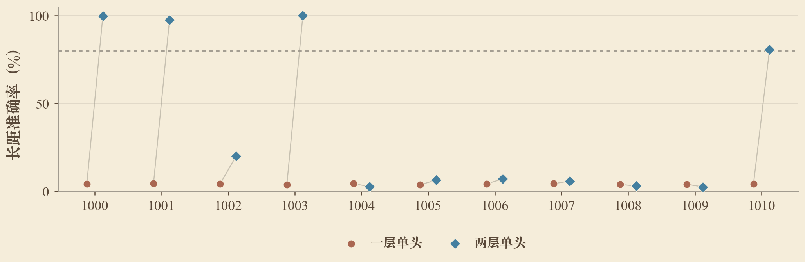

图4：一层与两层单头模型的逐种子对照，连线配对同一种子。虚线为基本学会的80%界线。

### 3.2 从局部关联到远距读取的机制检验

第3.1节说明了两层单头能够基本学会。**接下来，我们先检查刚刚比较的两层模型，判断它们是否形成了假设中的两个头，再进一步检查这些头传递和使用了什么信息。**

在我们的键值匹配任务中，跨层归纳头机制预期：较早一层的“局部关联头”在值的位置读取前一词元，也就是键；较晚一层的“检索头”根据前一层带来的键信息匹配查询，注意力集中到所需的值上。以“A 4 …… A”为例，第一层让4的位置获得A的信息，第二层再让查询A从这个位置取回4。这对应原文中跨层的内容匹配与值读取。[Olsson等（2022），Argument 5](https://arxiv.org/pdf/2209.11895#page=26)

我们首先对照成功训练与未成功训练的两层单头模型，观察它们在进行键值匹配时的注意力。

图5按种子分别展示两层的两个头。基本学会的两个种子中，第一层在值位置对前一键分配较多注意力，第二层在查询处明显读取原值；未学会的种子没有形成同样强的读取。这与先建立局部关联、再远距读取的解释相符。两个成功种子对源键的直接关注也有差异，因此还需要检查它们实际传递和使用了什么信息。

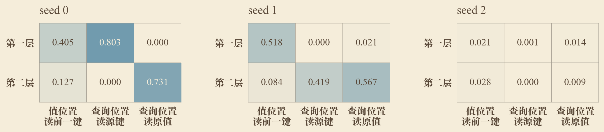

图5：两层单头模型的注意力分工，每个面板对应一个种子。行对应两个头，三列依次为值读取前一键、查询读取源键和查询读取原值的平均注意力权重。

**为了进一步检查不同层中头所反映的信息，** 我们提取相应位置的隐藏状态向量 $h$，用线性探针训练一个分类器，也就是根据该层位置的向量尝试预测源键（检测“局部关联头”），或是答案值（检测“检索头”）。假若预测能够达到高准确率，则说明该层的表示已经反映了相应信息，进一步为机制提供支持依据：

$$
\hat y=\arg\max_c(Wh+b)_c.
$$

探针只更新分类器的 $W$ 和 $b$，Transformer保持冻结。每个位置、每个预测目标分别训练一个分类器，并用另外生成的序列评测。键和值在每条序列中重新随机配对，因而测试检查的是该位置的向量能否提供当前序列中的关联信息。

**为了检查预测表现是否来自向量与实际键值的对应关系，我们设置打乱标签的对照。** 这里的标签就是每个向量应当对应的源键或答案值：保留所有隐藏向量不变，在训练、验证和测试集内各自随机重排标签，再按相同设置重新训练并评测分类器。这样，各类键或值出现的次数不变，但向量与它实际对应的键或值之间的关系被打乱。比较两者，就能检查正确的对应关系是否带来了更高的预测准确率。

我们在同一组两层单头模型上完成这两项比较：从4的输入嵌入与第一层输出分别预测前一键A，从查询A的输入嵌入与第二层输出分别预测答案4。图6显示，基本学会的两个种子中，经过第一层后，从值位置预测前一键的准确率明显提高；经过第二层后，从查询位置预测答案值的准确率也明显提高。这说明相应位置的表示已经反映了键信息和答案信息。未学会的种子中，从值位置预测前一键仍接近机会水平，从查询位置预测答案的能力也明显较弱。打乱标签后，没有出现相同的提高。

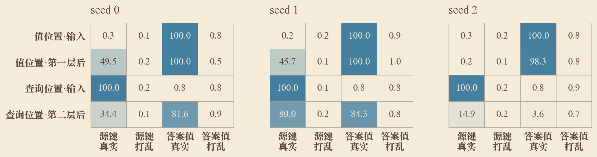

图6：两层模型的源键与答案值预测，每个面板对应一个种子。各格为相应位置表示的线性分类准确率（%），并保留打乱标签对照。

**注意力和探针结果支持了两个头的分工，接下来还需要检验，模型在回答时是否确实使用了这两步计算。** 如果第一层建立局部关联、第二层取回答案，那么阻止其中任一步，原本正确的回答就应受到影响。基于这一想法，我们在评测时分别不允许第一层在4的位置读取前面的A，或者不允许第二层在查询A处读取原值4的位置。参数与输入保持原样，只限制指定位置之间的注意力读取。为了判断下降是否来自对相关位置的限制，我们同时限制相应层对无关词元的读取作为对照。基本学会的两个种子在前两项干预下，长距检索都明显下降；无关词元的对照则基本保留原表现，见图7。

在限制具体读取之后，我们再将两个头在查询处的输出分别置零，检查各头对查询计算的整体贡献。将第二层头的输出置零会破坏检索，第一层头的输出置零也有明显影响。结合图5中第一层头在查询处对源键的关注，可以看到，这个头除了在值位置处理前一键，也参与查询位置的计算，因此不能把它作为“无关头”对照。

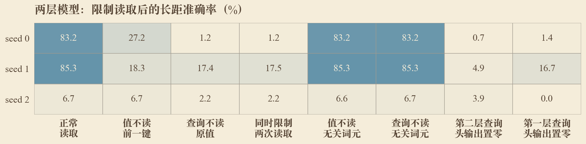

图7：两层模型在限制指定读取、限制无关词元读取及移除头输出后的长距准确率，各行保留一个种子。末两列分别将第二层和第一层头在查询处的输出置零。

**限制读取说明这两步计算会影响回答，我们进一步检验，它们传递的是否就是当前查询的答案信息。** 为此，保持键A和查询不变，只把源值4替换成7，使正确答案随之改变；同时保存原输入计算出的第一层值位置表示和第二层查询头的输出。如果这些表示传递了原答案4的信息，把它们分别放回替换输入的计算中，就应使回答重新偏向4。

对于成功模型，替换源值后，回答随之转向7；放回上述任一种原表示后，回答原值4的比例均提高。两个种子的恢复程度不同，恢复无关位置的表示则没有这一效果，见图8。

这组比较说明，第一层值位置的表示与第二层查询处的读取输出传递了能够改变答案的信息。未学会的种子没有出现与成功种子相当的原答案表现，图中保留它的完整读数。

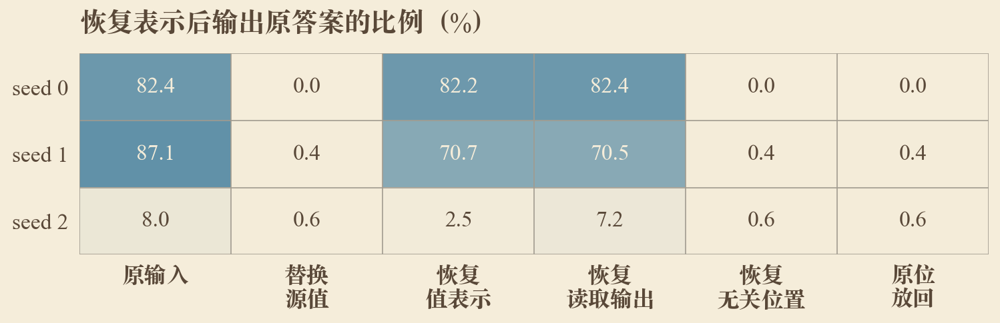

图8：两层模型替换源值、恢复原表示后的原答案输出比例（%），每行对应一个种子。

**在两层模型上验证这一机制后，我们进一步在四层模型上检验它是否仍然成立。** 本文主实验采用四层结构；这里仍保持每层单头，先检查增加深度后，局部关联与远距读取是否仍然存在、分别发生在哪些层。我们先观察一个成功四层单头模型的逐层注意力，再沿用前面的探针与干预进行验证。图9左侧显示，局部关联与远距读取分别集中在第二层和第三层的头，第四层也保留了对原值位置的关注。下文分别将第二层、第三层的这两个头称为局部关联头与检索头，并沿着它们检查表示和作用。

四层模型的探针因此取自源值位置经过前两层计算后的表示，以及查询位置经过前三层计算后的表示，并分别与同一位置的输入嵌入比较。图9右侧显示，前两层计算后，从源值位置预测源键的能力增强，同时仍能预测源值；前三层计算后，从查询位置预测答案值的能力增强。沿用前面打乱标签的对照，按相同设置重新训练和测试，未出现相同表现。这说明源值位置的表示已经反映了键值信息，查询位置的表示也已经反映了答案信息。

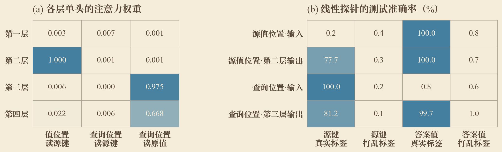

图9：四层单头seed 1的注意力与表示探针。左侧为逐层平均注意力权重，右侧为指定位置与阶段的表示预测源键或答案值的准确率（%），并保留打乱标签对照。

**四层模型中也出现了与两层相似的注意力分工和表示变化，接下来同样需要检查，模型是否通过这些计算完成回答。** 因此，我们在刚刚定位的第二层、第三层分别限制相应读取：一次不允许值4的位置读取前面的A，另一次不允许远处的查询A读取原值4的位置。模型参数和输入词元保持原样，只改变指定位置之间的注意力读取。两种限制都会明显破坏检索。作为对照，我们在相同的层限制对无关词元的读取，模型仍能正常回答。因此，造成下降的是这两次与答案有关的读取受到限制，见图10左下。

为了进一步检查所定位的头对查询计算的贡献，我们也将查询位置的检索头输出置零，并与其他层头的输出置零比较。移除检索头的输出同样破坏了回答，完整读数见[附录D.10](附录.md#appendix-d-10)。

**在确认这些读取会影响回答后，我们继续检查相应表示是否传递了具体的答案信息，沿用两层实验中的源值替换与表示恢复。** 把输入中的源值4改成7后，模型会回答7。接着，在同一层、同一位置，把原输入计算出的向量放回改动后的计算中：放回值位置的原表示，或者放回查询处原来读到的信息，都能使预测重新回到原值4；放回无关位置的原表示则没有这一效果，见图10右下。这说明这些位置传递的确实是回答查询所需的答案信息。

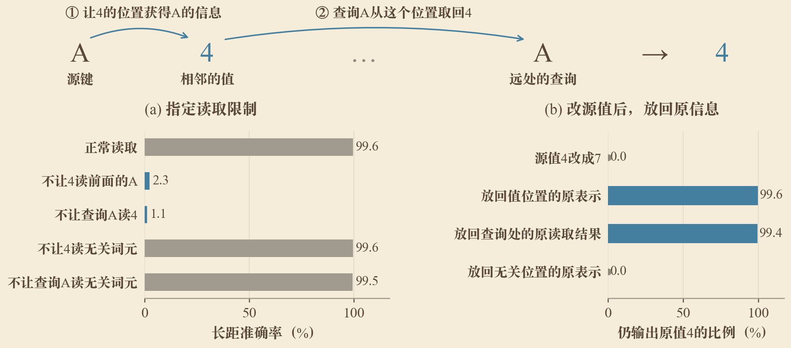

图10：四层单头seed 1的读取限制与表示恢复。上方以“A 4 …… A”说明计算过程；左下比较限制指定读取后的长距准确率，右下比较替换源值并恢复表示后输出原答案的比例。

上述结果来自一个四层模型。**为了检验这一机制是否也出现在其他训练结果中，** 我们在另外两个成功的四层单头种子上完成了同样的注意力观察、线性探针、读取限制和表示恢复实验。不同种子中，局部关联与远距读取发生的层数有所不同；限制相应读取都会破坏检索，而恢复相关表示能够重新提高原答案的分数，见图11。无关词元读取限制与无关位置恢复分别保留在对照中。逐头置零还显示，部分种子的较早层也参与查询位置的计算，相关读数一并保留在[附录D.13](附录.md#appendix-d-13)。

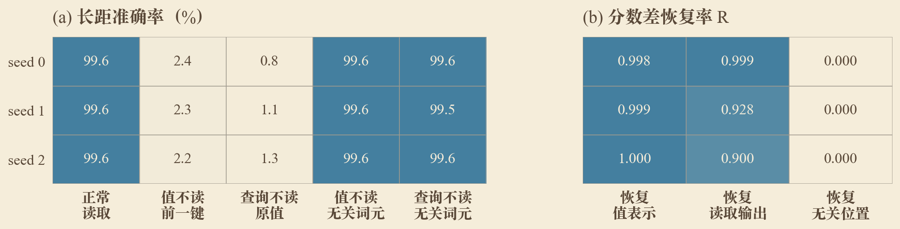

图11：三个四层单头种子的读取限制与表示恢复，各行对应一个种子。左侧为长距准确率（%），右侧为原答案相对替换答案的分数差恢复率R。

> **长距检索依赖局部键值关联与后续读取的配合，这两步计算可以由不同层承担。**

已有两层四头模型中，限制第二层查询对原值位置的读取也会破坏检索，结果见[附录B](附录.md#appendix-b)。

四层模型中的层次差异也提示我们，在更深的模型中，答案信息可能要经过更多层计算才出现在查询表示中。为此，我们补充比较已有八层模型的逐层探针。从查询位置的表示预测答案，准确率主要到后层才明显提高，说明这些后层表示已经反映了答案信息，见图12。结合四层模型的结果，可以看到增加深度后，这两步计算不一定发生在最早两层，需要沿层追踪它们分别发生在哪里。

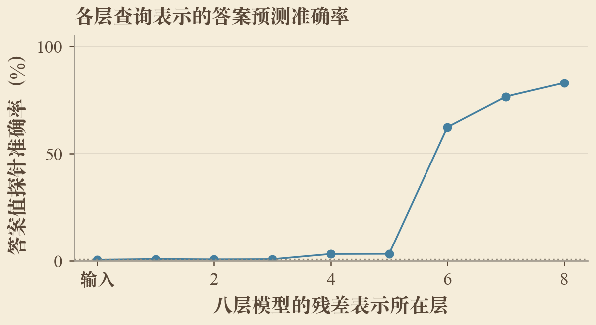

图12：八层模型各层查询表示预测答案值的准确率。折线连接各层结果，虚线为机会水平。

**上述机制还为H1提供了一个进一步的检验思路：** 如果较早一层的作用是把前一键的信息带到值的位置，那么直接提供前一词元的信息，就可能让一层模型也能完成任务。这对应H1中“未直接提供邻接信息”的结构前提。原文的smeared-key改动混合当前与前一位置的注意力key向量；本文的smear是在输入处加入前一词元的可学习嵌入贡献，用来补充邻接信息。加入这一改动后，一层单头模型也能迅速学会任务，结果见[附录D.4](附录.md#appendix-d-4)。结构补偿、注意力观察、表示探针和干预分别从不同方面支持同一解释：先建立键值关联，再根据查询取回答案。接下来考察这两步对位置信息与训练监督的要求。

### 3.3 位置信息与局部关联的建立

上一节将深度的作用具体化为局部关联与后续读取。**这也使位置编码成为有明确理由检验的变量：** 键和值在局部相邻，查询与源键则在内容上相同、位置上相隔较远，所提出的机制需要同时处理这两种关系。

**假设H2：位置设置影响模型建立局部键值关联；若学习困难主要来自这一环节，直接补充邻接信息应当恢复检索学习。** 因而，我们用少数位置设置检验局部信息怎样获得，而不搜索所有位置编码的性能排名。

我们在相同任务和训练设置下比较RoPE、ALiBi与无显式位置编码（NoPE），并加入NoPE、ALiBi各自与smear的组合。这两组对照直接提供相邻词元的信息，用来考察这些位置设置下的困难是否能够通过辅助局部计算缓解。

普通NoPE与ALiBi模型在共同预算内学习不足。

> **补充邻接信息可以缓解局部关联的学习困难，显式位置编码并非完成检索的必要条件。**

这支持H2关于局部关联学习困难的解释，同时说明显式位置编码并非完成检索的普遍前提。不过，ALiBi加入smear后仍未恢复到相同表现，因此邻接信息的补充尚不能解释所有位置设置下的困难。后续需要继续检查局部关联与远距匹配各自的变化。初轮与新增逐种子结果见图13及[附录D.1](附录.md#appendix-d-1)。

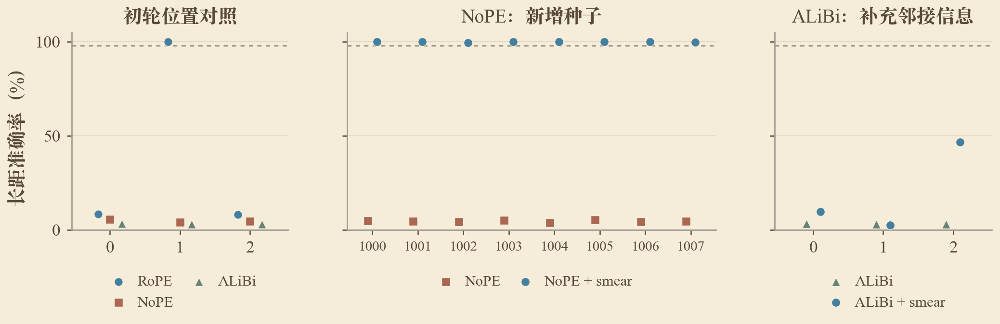

图13：位置编码与邻接信息的逐种子对照：左为RoPE、NoPE与ALiBi，中为NoPE补充邻接信息前后，右为ALiBi补充前后。虚线为98%参考线。

### 二、数据条件

### 3.4 长距离依赖的监督覆盖

前面的比较考察什么模型能够实现检索。**接下来检验，具备这种计算能力是否意味着仅靠短距训练就能学会利用远处信息。** 一条序列可以很长，而所有受到监督的依赖都很短；因此，输入长度与长距离上的学习信号需要分别控制。

**假设H3：在本文的模型与训练条件下，可靠的长距检索需要训练数据覆盖长距离依赖。** 这一假设的依据是，模型需要将局部学到的关联用于远处查询，而训练目标是否要求这样做，会改变它收到的学习信号。我们固定上下文长度和模型，只移除或恢复长距监督，以检验这一覆盖要求。

已有短距训练模型能够完成训练范围内的检索，却几乎不能回答远距离查询；长距训练模型则能在相应范围内达到高准确率。在此基础上，我们用相同预算比较纯短距、短长混合和纯长距训练，逐步增加长距查询的比例。这样可以考察移除长距监督造成什么影响，以及恢复多少监督便足以学会。

我们将长距查询比例设为0%、3.125%、25%和100%，保持每次更新的序列数、查询总数和总更新数相同。短距训练范围为4至96，长距范围为512至1022。所有模型都在共同的长距测试集上评测。

移除长距监督后，模型没有建立可靠的长距检索；恢复少量长距监督后，模型便能够学会，新增种子也保持了这一差异，见图14。

> **在本任务中，可靠的长距检索需要相应的监督覆盖，输入足够长本身并不充分。**

恢复长距监督使模型学会了目标范围内的检索。在此基础上，继续增加长距样本能否减少训练量，属于问题二，将在第4.2节比较。

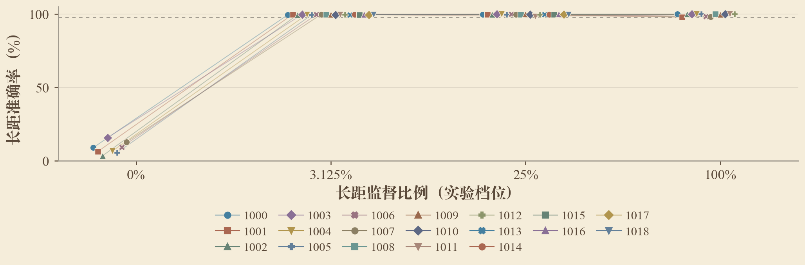

图14：长距监督覆盖与长距准确率，散点表示各个种子，细线连接同一种子。横轴按实验档位排列，虚线为98%参考线，缺失组合留空。

### 3.5 训练分布与读取路径的差异

**基于第3.2节对于模型利用键值关系的探究，一个自然的想法是：虽然学会的是同一任务，不同的数据分布会不会导致不同的读取方式？** 前一节已经说明长距监督能够促使模型学会；这里进一步比较学会后的模型，检查它们从哪里取回答案。

还是以“A 4 …… A”为例：一种模型在最后看到A时，直接读取前面4的位置；另一种模型会先把A和4的信息传到更靠后的其他位置，最后再从这些位置取回答案。我们把后者称为通过中继位置读取。

中继位置原本可以是背景词元x、y所在的位置，并不是额外加入的键值对。训练改变的是模型在这些位置计算出的表示，使其中能够携带前面键或值的信息；输入中的x、y本身没有被改写成A或4。图15上方展示了直接读取和通过中继读取的区别。

为判断模型实际使用哪种读取方式，我们先观察查询主要关注哪些位置，再检验这些位置是否确实参与回答。如果限制查询读取某个位置后，原本正确的回答受到影响，就说明模型依赖该位置完成检索。基于这一想法，我们保留原始键值对和所有输入词元，只限制查询对指定历史位置的读取。实验包括六个已训练模型，每个模型比较八种条件；四层模型在最后两层限制读取，两层模型在第二层限制读取。图15中的“后7/8位”指源键之后的第7、第8个位置，其他列同理。

图15显示，全距均匀训练的模型主要依赖原值位置：不让查询读取原值，回答就会受到破坏。一个纯长距模型则依赖源键之后第7、第8个中继位置；限制查询读取原值几乎没有影响，限制读取这两个中继位置却会破坏检索。

> **完成同一检索任务并不要求相同的读取路径，直接读取与中继读取都可以实现。**

同样接受纯长距训练的不同种子也会学出不同路径。有的直接读取原值，有的使用较近的中继位置，有的把读取分散到多个位置。对于读取较分散的模型，仅限制两个主要位置还不能完全破坏检索；限制读取源键之后更大范围的位置，影响才更明显。各模型的结果分别保留在图15与[附录B](附录.md#appendix-b)中。

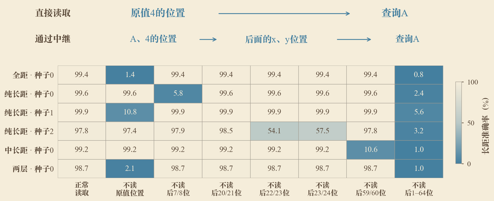

图15：上方说明直接读取与中继读取；下方每行对应一个模型及种子，各列比较正常读取与指定位置的读取限制，颜色越深表示长距准确率越低。“后7/8位”等均从源键向后计数，原值位于后第1位。

读取路径的差异也体现在可处理的距离上。因果注意力无法读取查询之后的位置；依赖较远中继位置的模型在短距查询上表现较差，查询越过这些位置后，表现逐渐改善，而全距模型已能处理这些短距查询，见图16。这使短距表现的差异与模型采用的读取路径联系起来。

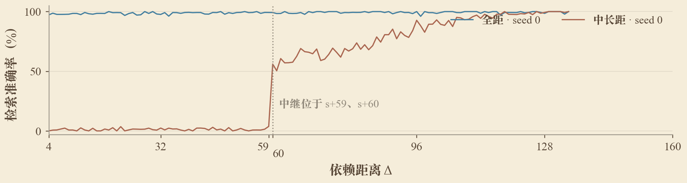

图16：全距seed 0与使用s+59、s+60中继位置的中长距seed 0在各依赖距离上的准确率，折线连接实测结果。竖线标记中继位置附近的距离边界。

以上实验共同回答问题一：两层单头可以学会检索，直接提供邻接信息也能使更浅模型完成任务；在这样的模型上，长距监督使所学计算用于远处查询。遮挡分析则表明，成功模型确实依赖特定位置的读取，但这些位置和信息传递路径可以不同。由此，学习所需的计算与它的具体实现方式得以区分。

## 4 问题二：有利于长距检索学习的条件探究

**确定能够学会的条件之后，我们转向学习效率。** 问题一比较移除或恢复某个条件是否改变学习结果；这里主要在能够完成任务的配置之间比较达到相同准确率所需的训练。同样是改变深度或训练距离，此时要解释的是为什么某种配置能更早学会。

**实验设置。** 有利性的直接比较采用共同的高精度目标：开发集长距准确率连续三次达到98%，以第三次检查点的累计更新数作为稳定达标时间。每次更新的输入量相同，短距预训练也计入总训练量。某个种子在预算内未达标时保留该记录，不把训练上限当作其实际达标时间。这个标准用于比较学习用量，第3.1节关于基本学会的判断仍使用该节的标准。

我们先比较额外容量是否减少训练，再比较已覆盖目标距离时怎样分配和安排样本，最后追踪训练中的计算变化。各配置按种子分别比较，完整结果保留在图表与附录中。

### 4.1 独立结构变量与学习效率

第3.1节研究了实现检索的最小结构。能够表达这套计算之后，更深、更宽或更多头的模型是否更容易把它学出来，是进一步需要回答的问题。**为此，我们保持其他变量不变，分别考察层数、宽度和头数，而不把它们合并成一个模型规模指标。**

结构增加同时改变了可用计算及其学习难度。例如，在隐藏宽度不变时，增加头数意味着每个头的维度缩小。[Bhojanapalli等（2020）](https://proceedings.mlr.press/v119/bhojanapalli20a.html)分析了这一权衡，并观察到头数增加到一定程度后性能收益反转。这为分别寻找各结构变量的合适取值提供了依据；我们进一步检验它们对本任务学习用量的影响。

基于这一考虑，我们提出：

**假设H4：在任务、训练配方及其他模型条件不变时，每个独立结构变量都存在使学习所需训练量最少的取值。** 若最优点位于所考察范围的内部，可能呈现U形关系；若位于最低端，则可能随该变量增加而递增。因此，实验要分别确定各变量的变化趋势与最优位置，而不预设它们具有同一种曲线。

所有结构比较使用loguniform距离采样，并共享4层、宽256、4头的基线。我们将层数、宽度和头数各扩展到五档，按新增种子分别比较稳定达标步数。图17至图19保留各个种子的散点和细线，并叠加一条总体拟合曲线及其置信区间。

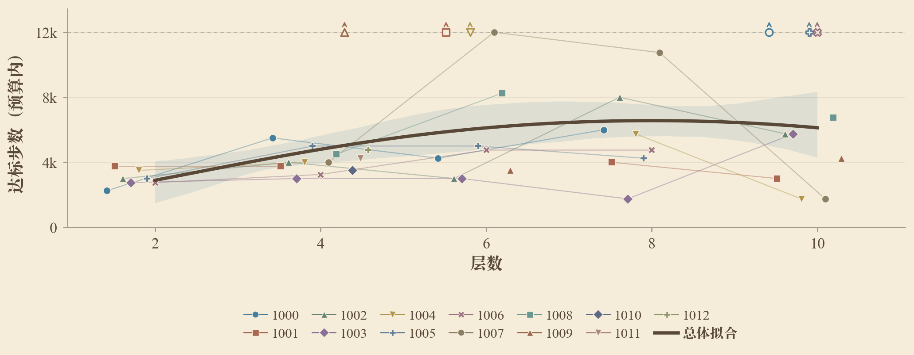

图17：层数与学习步数：散点和细线保留各个种子，粗线为预算内受限步数的总体拟合，阴影为种子重抽样的95%区间。空心箭头表示12000步内未达标。

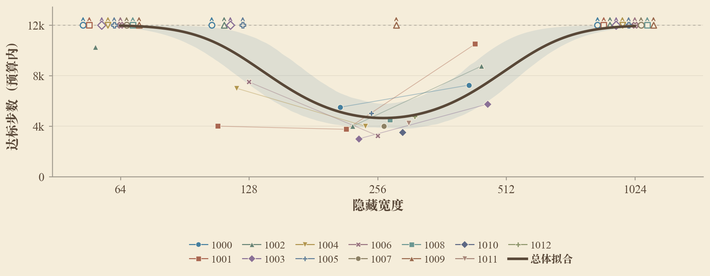

图18：宽度与学习步数，横轴为对数间距。逐种子散点、连线、预算内受限步数的拟合、区间及未达标箭头含义同图17。

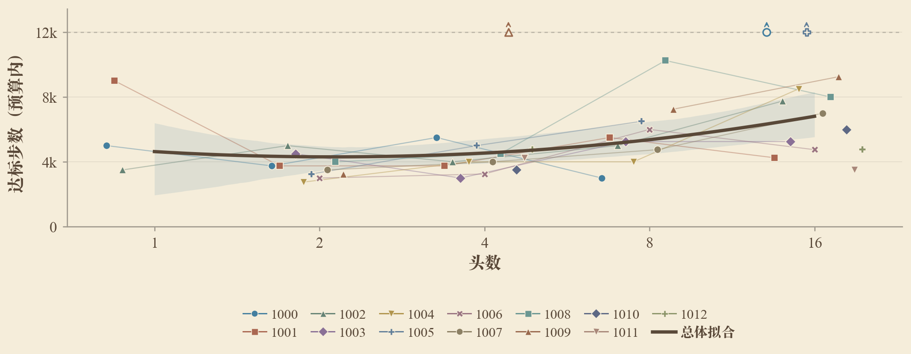

图19：头数与学习步数，横轴为对数间距；总注意力宽度固定，单头维度随头数改变。逐种子结果、预算内受限步数的拟合、区间及未达标箭头含义同图17。

总体拟合显示，三个结构变量的趋势并不相同。宽度对照中，中间配置更快；层数与头数的结果则有更明显的种子差异。

> **学习效率取决于各结构变量的具体取值，不能由模型规模单独判断。**

图中同时保留实际达标步数和未达标记录，以便判断拟合所依据的结果。这里的学习成本以更新数和训练词元数衡量。

结构对照比较了不同模型的学习用量。接下来，我们固定模型，进一步检验数据的距离采样和训练顺序能否减少训练。

### 4.2 距离采样与训练顺序

第3.4节检验目标距离的监督是否需要存在。**现在，在已经覆盖目标距离的训练中，我们改变距离权重和出现顺序，研究怎样使模型更快学会。**

**假设H5：短距学习有助于建立能够用于远距检索的局部计算，因此提高短距权重或先进行短距训练，可以减少后续长距学习所需的总训练量。** 这一假设与前面的归纳机制相联系：局部键值关联不必等到最远的查询出现时才开始学习。这里的短距预训练是数据课程，学习率预热设置保持不变。

监督比例实验首先提供了能够达到共同目标的比较。不同混合比例覆盖同一组短距与长距范围，只改变出现频率；在两种短长混合配置之间，提高长距比例通常减少了所需更新，但进一步转为纯长距训练并未持续加快学习。纯长距这一端点还同时移除了短距样本，因此该比较提示保留短距训练可能有益。初轮与新增种子的逐项成绩和达标步数见图20与[附录D.2](附录.md#appendix-d-2)。

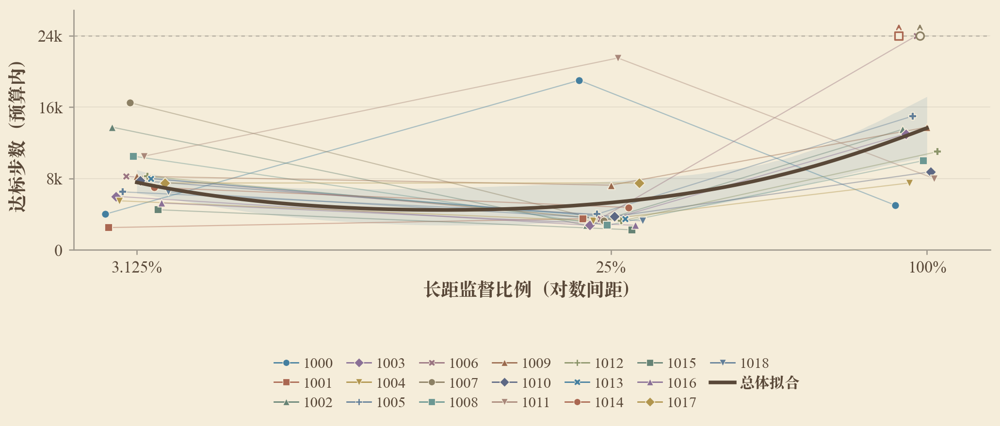

图20：长距监督比例与学习步数，空心箭头表示24000步内未达标；其余逐种子标记、预算内受限步数拟合及95%区间同图17。

uniform与loguniform的比较进一步检验距离权重的作用。两者覆盖相同的距离范围，后者提高了较短距离的采样权重。相同预算的新增配对中，loguniform更容易学会，而uniform在共同预算内尚未稳定达标，见图21及[附录D.9](附录.md#appendix-d-9)。这为H5提供了支持，也表明训练中有没有某类依赖和它出现多少次，需要分别考察。

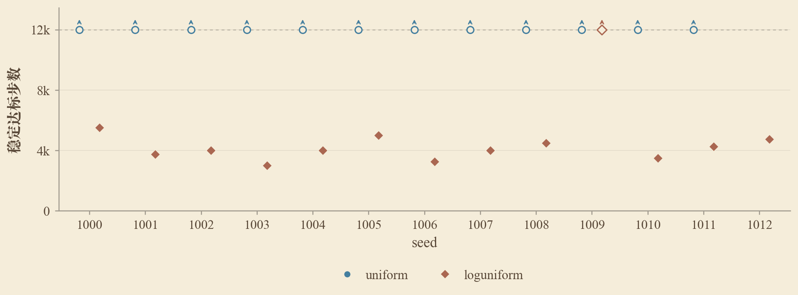

图21：uniform与loguniform采样的逐种子学习步数对照。空心点与向上箭头表示12000步内未稳定达标，未配对记录单独保留。

**我们随后用相同的训练批次检验顺序的作用。** 一组先进行3000步短距训练，再进行21000步全距训练；另一组使用完全相同的短距和全距批次，但将顺序打乱。两组具有相同的样本集合和总训练预算，短距阶段也计入学习成本。

先短后全训练更一致地学会了高精度检索，打乱顺序后仍有模型未学会，见图22。对两组都已达标的匹配种子，先短后全也使用了更少的累计更新。

> **监督覆盖相同时，距离采样权重和样本顺序仍会影响学习效率；先短后全是本次对照中的有利安排。**

逐种子的学习结果与达标时间见[附录D.8](附录.md#appendix-d-8)。

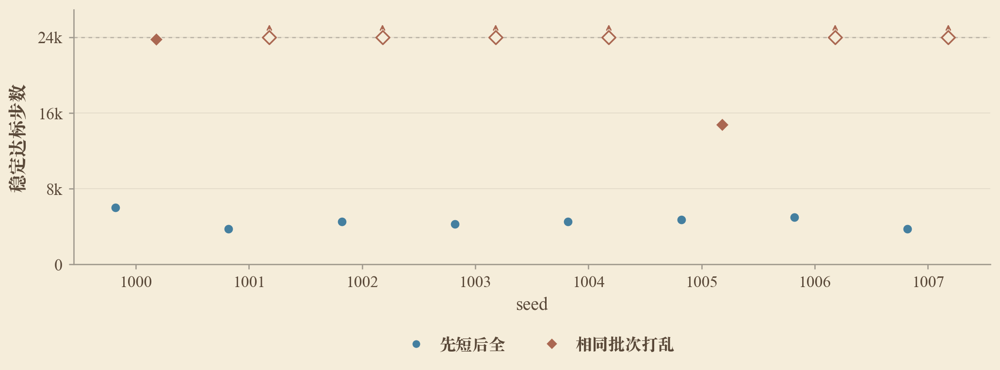

图22：相同训练批次采用先短后全与打乱顺序时的逐种子学习步数，短距阶段计入总更新数。空心点与向上箭头表示24000步内未稳定达标。

这一顺序效应使局部计算迁移的假设更加具体。短距预训练可能先建立键值关联，使后续训练能够集中学习远距读取。**要解释这一过程，需要从最终成绩转向训练中的模型，检查这些计算分别在什么时候形成。**

### 4.3 两次损失下降与检索回路的形成

前两节比较了不同条件下模型何时学会。要进一步解释学习速度，我们回到训练过程中的一个观察：成功运行的验证loss通常经历两次明显下降。第一次出现在训练早期，loss下降后仍有较长的低准确率阶段；第二次下降则往往伴随准确率飙升，见图23。因此，这两次变化可能对应不同的学习进展，仅看最终准确率会把它们混在一起。

这一观察也与前面的机制分析相接。第3.1、3.2节说明，检索需要先建立键值关联，再完成远距读取；我们现在进一步追问，这些计算分别在训练的哪个阶段形成。Reddy从准确率跃升前的注意力和训练进展出发，逐步构造并检验归纳头形成的解释；Singh等则通过干预相关子计算，研究它们怎样共同形成loss的阶段变化。本文也先分辨两次下降对应的变化，再沿已经定位的计算继续检查。[Reddy（2024），§3](https://arxiv.org/pdf/2312.03002)；[Singh等（2024）](https://proceedings.mlr.press/v235/singh24c.html)

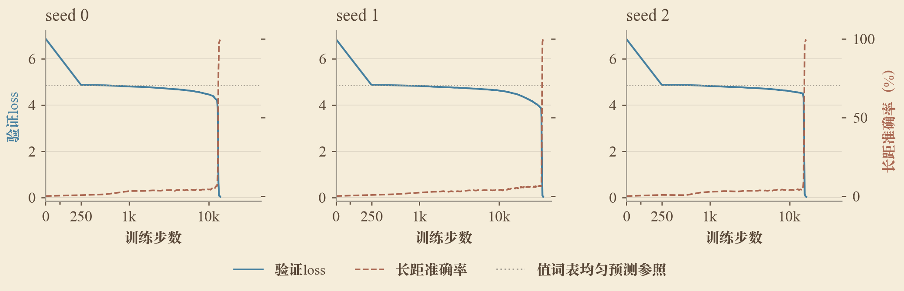

图23：三个四层单头种子的验证loss（实线）与长距准确率（虚线），横轴在250步内为线性步距、之后为对数步距。灰线为在128个值中均匀预测的loss参照。

**为了区分“只会输出可能的答案”和“已经根据键找到答案”，** 我们回到第3.1节的两层单头模型，取训练中专门保存的首次loss下降检查点，与初始模型在同一批序列上比较。先检查输出概率落在键、值和背景词表中的比例，再检查查询处的两个头关注哪些词元，并与按可见位置均匀分配注意力的结果对照。

三个种子在第一次下降后，都已将输出概率主要集中到值词表，长距检索却仍接近在值中猜测的水平。第一层的注意力接近均匀分配；第二层已经有所偏离，但仍未集中读取查询所需的原值，见图24。这说明第一次下降主要对应答案候选范围的缩小：模型先排除了键和背景作为答案，尚未完成当前序列中的键值匹配。四层模型在第一次下降后的低准确率阶段也保持了这一输出倾向，补充读数见[附录D.14](附录.md#appendix-d-14)。

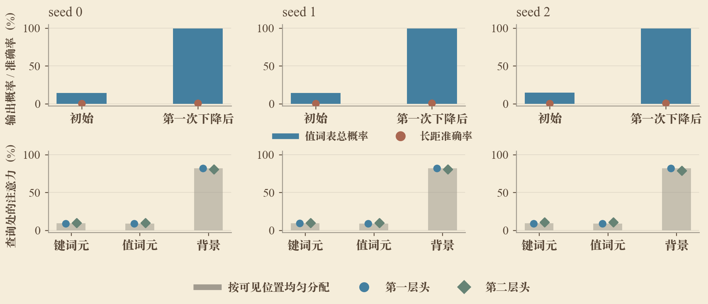

图24：两层单头模型首次loss下降前后的逐种子比较：上排为值词表的输出概率总量与长距准确率，下排为110步时两个头对键、值和背景的注意力总量。灰柱为按可见词元数量计算的均匀注意力参照。

基于两次下降的观察及第3.2节的机制依据，我们提出：

**假设H6：第二次loss下降与准确率骤升，对应局部关联与远距读取开始有效配合；有利的训练条件通过提前建立其中的计算，促使模型更早学会。**

**我们先检验H6关于第二次下降的解释：准确率跃升时，局部关联和远距读取是否开始配合。** 为此，沿成功四层单头模型的训练轨迹，分别追踪值位置对前一键、查询位置对原值的注意力，并与长距准确率对照。

图25显示，跃升前局部关联已经增强，远距读取仍然较弱；随后远距读取明显增强，准确率同时提高。这与H6的预期一致：局部关联的学习可以先于准确率变化，后续还需要形成有效的远距读取。

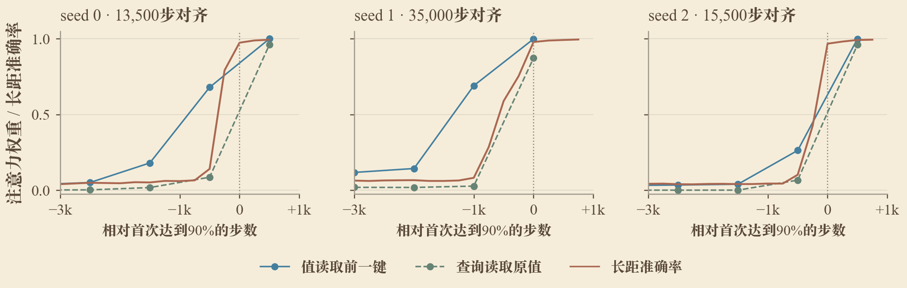

图25：三个四层单头种子的局部关联、远距读取与长距准确率，横轴按各自首次观测到90%准确率的步数对齐，折线连接实测检查点。90%只用于时间对齐。

**原训练轨迹支持了两步配合的解释，接下来检验H6的后半部分：有利的训练条件能否通过提前建立其中的计算，帮助模型更早学会。** 第4.2节已经观察到先短后全的优势，因此这里回到相同批次、不同顺序的对照，比较短距阶段结束及转入全距后的模型。

图26将两种读取的注意力与未施加读取限制时的长距准确率放在一起比较。先短后全的模型在短距阶段结束时，局部关联已经较强，但远距读取和长距准确率仍低；转入全距训练后，远距读取增强，准确率随之提高。在转入全距后的相同步数下，打乱顺序组的长距准确率仍然较低。这与H6的解释一致：课程先帮助局部关联形成，随后模型更早学会将其用于远距检索。

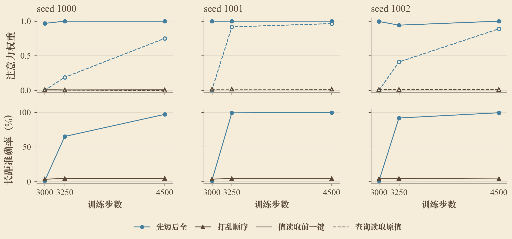

图26：每列一个种子，上排为局部关联与远距读取的注意力，下排为未干预模型的长距准确率。横轴为实际步数。打乱组seed 1001、1002未定位到关联路径，其虚线仅表示候选位置注意力。

> **两步计算的配合与长距能力跃升相对应；课程训练支持先建立局部关联、再更早学会远距读取的解释。**

## 5 核心结论的稳健性验证

前面的实验分别讨论了能否学会与如何更早学会。补充验证围绕支撑主要结论的对照展开：检验最小结构的成功实例、长距监督的作用，以及训练顺序带来的学习差异是否能够复现。

### 5.1 核心对照的跨种子验证

**前面的判断能否在不同训练种子下保持，是本节验证的重点。** 我们对主要模型条件和数据条件增加独立种子，在各组共同的预算与评测设置下重复比较，并以独立训练种子为单位进行统计检验。

对于能否学会，新增种子中再次出现了两层单头的成功训练，说明这一最小结构的可实现性能够复现。NoPE补充邻接信息，以及从纯短距训练恢复少量长距监督的对照，也通过了校正后的显著性检验。两层单头的训练结果仍有较大的种子差异，其与一层单头的整体准确率比较尚未达到校正后的显著性阈值。

> **邻接信息、长距监督与距离采样的作用得到跨种子支持；结构速度与课程优势仍需更多统计证据。**

因此，课程训练的有利性目前主要由逐种子比较和第4.3节的形成过程分析支撑。逐项效应、检验方法、多重比较校正及未达标运行的处理见[附录D.12](附录.md#appendix-d-12)。

### 5.2 更长训练上下文

前面的主体实验使用1024上下文。**受时间与算力限制，我们只在更长上下文中开展了部分结构与训练条件对照，重点检查长距检索能力及其机制能否复现。** 各长度沿用相同的相对长距定义，完整配置与逐种子结果见[附录D.5](附录.md#appendix-d-5)。

4096上下文中已有模型学会长距检索，也保留了明显的种子差异。在成功模型上，我们进一步沿用第3.2节的注意力观察和读取限制，检查更长输入下是否仍然依赖局部关联与远距读取。限制所定位的局部读取都会降低表现，限制单个远距读取头的影响则因模型而异，见图27。

> **局部关联与远距读取的分工可用于4096上下文中的检索，具体读取路径仍可不同。**

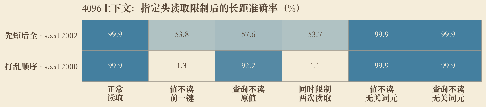

图27：4096上下文中两个两层四头模型的读取限制，每行对应一个训练种子。比较正常读取、限制局部关联、限制远距读取及限制无关词元读取后的长距准确率。

## 6 扩展：长度外泛化与机制导向的改进

### 6.1 冻结模型的长度外泛化

在研究训练长度内的学习之后，我们将模型冻结，直接用于更长的序列，考察已学会的检索能否继续工作。**这与上一节重新训练更长上下文的模型不同：参数保持不变，变化的是评测长度及其包含的依赖距离。**

训练长度内学会长距检索，并不保证长度外泛化。

不同训练条件下的模型均出现不同程度的下降，种子之间也有差异，完整读数见[附录D.6](附录.md#appendix-d-6)。这与本文开头的区分一致：在训练上下文内学会远距利用，与将其推广到新的长度和位置，是需要分别检验的能力。

这些差异提出了具体的机制问题：模型在新长度下是否仍能把键和值关联起来，查询是否仍能找到原来的读取位置，答案信息能否继续传到输出。已有路径分析提供了可检查的位置和层，使长度泛化的分析能够从“准确率下降了多少”进一步转向“哪一步不再有效”。该组评测同时增加了查询和干扰关联的数量，后续将分别控制距离、位置和干扰数量以比较各自的影响。

### 6.2 从学习困难出发设计改进

两个研究问题也为实际改进提供了依据：**先确定模型完成检索所依赖的计算，再针对学习这些计算的困难减少训练。** 已有实验给出两个方向，直接补充邻接信息，或用距离课程帮助局部关联先形成。

补充邻接信息与先短后全训练，分别从结构和训练安排上改善了检索学习。

第4.3节的阶段观察支持了课程训练中局部关联先建立、远距读取随后增强的过程。后续方法应由这里发现的具体困难导出：检查所引入的改动是否帮助形成所需计算，并在相同总预算下与基线比较。

## 7 讨论

### 7.1 计算分工与结构条件

**结构需求与模型需要自行建立哪些信息有关。** H1检验的标准结构没有直接提供相邻词元的信息，较早一层需要先建立键值关联，后续层才能根据查询利用这一关联。

直接补充邻接信息后，一层模型也能完成任务，说明最小深度需要结合信息的提供方式理解。

NoPE加入smear后的改善同样支持这一认识：深度和位置设置的作用，都与局部关联如何建立有关。

在具备这些计算的模型中，具体实现仍可以不同。局部关联与远距读取可以发生在不同层，键值信息也可以先传到中继位置，再被查询利用。因此，比较不同模型时，需要沿信息传递过程寻找承担相应计算的头和位置。某个成功模型依赖原值位置，并不意味着其他模型也必须从同一位置取回答案。

### 7.2 训练条件与检索计算的形成

**训练过程区分了输出范围的学习与上下文检索的学习。** 第一次loss下降后，模型已倾向于输出值词表中的词元，却仍不能根据当前序列中的键找到答案；在后续阶段，局部关联逐渐增强，远距读取形成后，准确率才明显提高。因此，学习进展需要结合模型已经完成哪一步计算来理解。

这一过程也解释了监督覆盖与训练顺序的不同作用。长距监督要求模型把所学计算用于远处查询；短距训练则可以先帮助局部关联形成，使后续学习有条件继续建立远距读取。

相同的训练样本，采用不同顺序会形成不同的学习过程；训练条件的作用与相关计算的形成阶段有关。

上述过程证据支持了课程训练的机制解释。五档结构对照已经完成学习速度比较，但尚未进一步确定各档速度差异来自局部关联还是远距读取的形成过程；新增结构训练保留了学习曲线和终点权重，没有保存完成这项比较所需的阶段权重。

## 8 Conclusion

本文围绕任务B，将“Transformer在什么条件下能够真正学会利用长距离信息”分为能否学会与能否更早学会两个问题，并区分训练上下文内的长距利用与长度外泛化。我们固定现代Decoder-only Transformer主干，以带随机背景和干扰关联的MQAR任务控制依赖距离，沿模型、数据与训练条件提出假设，再通过行为对照和机制实验检验。

对于能否学会，模型需要能够建立当前序列中的键值关联，并根据查询从远处取回答案。标准结构中的两层单头已经能够完成这一任务；注意力、线性探针与干预支持了先建立局部关联、再进行远距读取的跨层分工。直接提供邻接信息后，更浅的模型也能学会，说明结构要求与信息的提供方式有关，多头并非完成任务的必需前提。

在数据条件上，仅提供长输入或短距任务不足以促使模型利用远处信息，训练目标需要包含相应的长距依赖。我们的对照中，恢复少量长距监督便能使模型学会目标范围内的检索。在不同训练分布下，我们还观察到不同的读取路径，模型既可以直接读取原值，也可以通过中继位置传递信息；完成同一任务并不要求使用完全相同的头和位置。

对于更早学会，结构变量、距离采样和训练顺序需要分别考察。增加层数、宽度或头数并不持续减少学习用量，各变量需要寻找适合当前任务的取值。保留短距训练、调整距离采样权重，以及先短后全的安排提供了有利于学习的证据。训练过程进一步说明，这种帮助可以来自局部关联的提前形成，再由后续训练学会将其用于远处查询。

本文以1024上下文的多种子与机制分析为主体，受算力限制，只对更长上下文开展了部分扩展。4096中的成功模型表明，相近的检索计算也能在更长输入下学会；冻结模型的长度外评测则说明，训练范围内学会检索尚不能保证长度外泛化，后者需要单独检验。

## 9 Limitation

本文使用带随机背景与干扰关联的合成MQAR任务，重点研究键值检索。该任务便于控制依赖距离与监督分布，但这些发现尚未在自然语言任务、多步推理或大规模语言模型中验证。

结构与训练条件的比较覆盖了有限配置和训练预算。未学会的运行不能排除其他训练安排或更长训练下成功的可能；结构对照的学习成本以更新数和训练词元数衡量，尚未比较总计算量与实际训练时间。

机制分析集中在部分模型、读取路径和训练阶段。五档结构对照缺少相应阶段权重，尚不能说明各档学习速度的差异具体来自哪一步计算；课程实验观察到了局部关联提前形成与学习加速的对应关系，尚未单独改变这一形成时间来检验其作用。

受时间与算力限制，更长上下文只开展了部分对照。长度外评测还同时增加了查询和干扰关联的数量，尚未分离依赖距离、位置变化与干扰数量的各自影响。

## 10 Future Work

**后续将扩展任务类型。** 从合成键值检索进一步走向多步关联与自然文本中的信息利用，检验本文结论在更复杂任务中的适用性。

**后续将扩展上下文长度。** 本次结论主要建立在1024上下文实验上，未来将在更长上下文中继续探究长距离信息利用的学习条件。

## 参考文献

1. Olsson, C., et al. (2022). [In-context Learning and Induction Heads](https://transformer-circuits.pub/2022/in-context-learning-and-induction-heads/index.html). Transformer Circuits Thread.
2. Reddy, G. (2024). [The mechanistic basis of data dependence and abrupt learning in an in-context classification task](https://openreview.net/forum?id=aN4Jf6Cx69). ICLR. [本文阅读的作者预印本](https://arxiv.org/pdf/2312.03002)。
3. Singh, A. K., Moskovitz, T., Hill, F., Chan, S. C. Y., & Saxe, A. M. (2024). [What needs to go right for an induction head? A mechanistic study of in-context learning circuits and their formation](https://proceedings.mlr.press/v235/singh24c.html). ICML, PMLR 235:45637–45662.

4. Arora, S., et al. (2023). [Zoology: Measuring and Improving Recall in Efficient Language Models](https://arxiv.org/abs/2312.04927). [作者的MQAR实现](https://github.com/HazyResearch/zoology/blob/main/zoology/data/multiquery_ar.py)。
5. Bietti, A., Cabannes, V., Bouchacourt, D., Jégou, H., & Bottou, L. (2023). [Birth of a Transformer: A Memory Viewpoint](https://leon.bottou.org/publications/pdf/neurips-2023.pdf). NeurIPS.
6. Touvron, H., et al. (2023). [LLaMA: Open and Efficient Foundation Language Models](https://arxiv.org/abs/2302.13971).
7. Liu, N. F., et al. (2024). [Lost in the Middle: How Language Models Use Long Contexts](https://aclanthology.org/2024.tacl-1.9/). TACL, 12:157–173.
8. Agarwal, R., Schwarzer, M., Castro, P. S., Courville, A., & Bellemare, M. G. (2021). [Deep Reinforcement Learning at the Edge of the Statistical Precipice](https://papers.neurips.cc/paper_files/paper/2021/hash/f514cec81cb148559cf475e7426eed5e-Abstract.html). NeurIPS.

9. Bhojanapalli, S., Yun, C., Rawat, A. S., Reddi, S., & Kumar, S. (2020). [Low-Rank Bottleneck in Multi-head Attention Models](https://proceedings.mlr.press/v119/bhojanapalli20a.html). ICML, PMLR 119:864–873.

[查看独立附录：完整结果与补充材料](附录.md)
