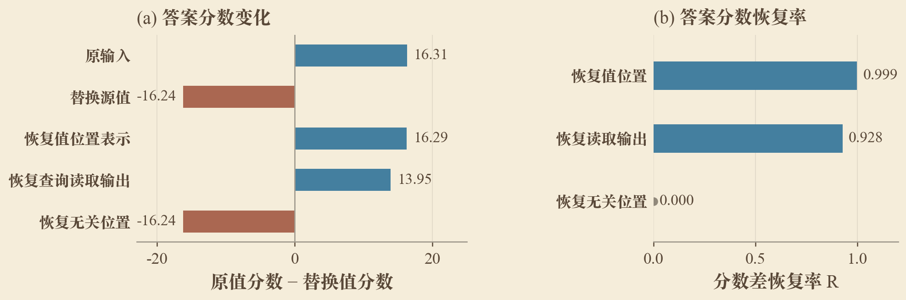
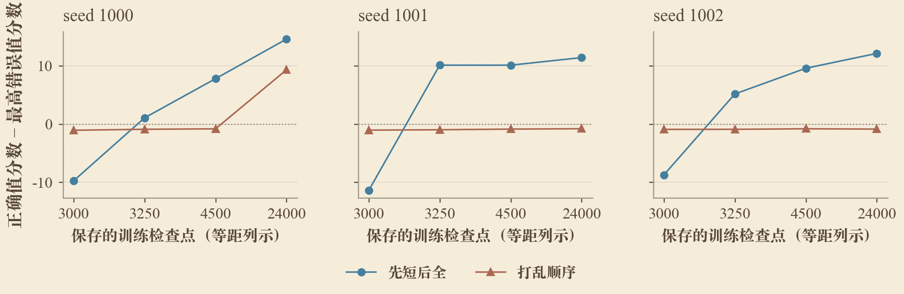
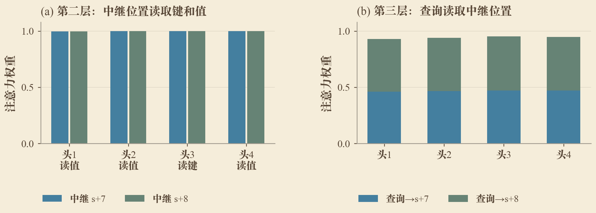
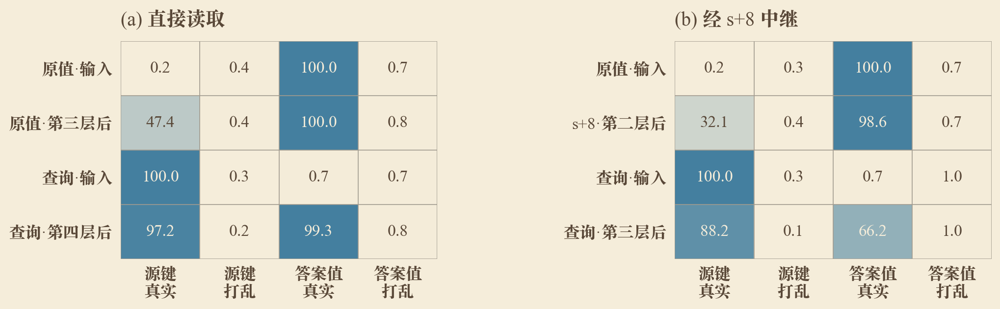

# 附录：Transformer 在什么条件下能够真正学会利用长距离信息

[返回正文](技术报告.md)

## 附录A 初轮19种配置的完整结果

准确率与步数均按seed 0、1、2顺序排列。稳定步数采用共同开发集连续三次达到98%的第三次检查点；“—”表示记录中未出现该事件。最终测试成绩来自保存的实际终点，M02两条续训读数单列于[附录D.4](#appendix-d-4)。

| 组 | 条件 | 最终长距准确率% | 稳定达标步数 | 实际保存步数 |
|---|---|---|---|---|
| M01 | 检验一层单头能否在既定预算内学会 | 4.03 / 4.13 / 3.70 | — / — / — | 64000 / 64000 / 64000 |
| M02 | 检验两层单头是否已足够 | 82.93 / 84.91 / 6.79 | — / — / — | 64000 / 64000 / 64000 |
| P01 | 检验无位置编码的普通模型 | 5.65 / 4.07 / 4.74 | — / — / — | 24000 / 24000 / 24000 |
| P02 | 检验ALiBi下的学习 | 3.28 / 3.21 / 3.18 | — / — / — | 24000 / 24000 / 24000 |
| P03 | 直接提供邻接信息后检验NoPE检索 | 99.83 / 99.53 / 99.95 | 1250 / 2250 / 1750 | 1250 / 2250 / 1750 |
| D00 | 完全移除长距查询监督 | 9.95 / 19.04 / 13.41 | — / — / — | 24000 / 24000 / 24000 |
| D03 | 只提供3.125%的长距查询监督 | 99.74 / 99.75 / 99.75 | 5750 / 5750 / 8000 | 24000 / 24000 / 24000 |
| D25 | 提供25%的长距查询监督 | 99.93 / 99.96 / 99.42 | 2750 / 7000 / 3000 | 24000 / 24000 / 24000 |
| D100 | 仅提供长距查询监督 | 98.50 / 99.98 / 99.97 | 18750 / 6250 / 14750 | 24000 / 24000 / 24000 |
| C00 | 直接全距离训练；共享RoPE位置对照 | 8.38 / 99.98 / 8.26 | — / 7500 / — | 24000 / 24000 / 24000 |
| C01 | 先短距3000更新再全距21000更新 | 99.99 / 99.99 / 99.98 | 7500 / 5750 / 7250 | 24000 / 24000 / 24000 |
| C02 | 相同3000短距与21000全距批次，打乱顺序 | 7.91 / 7.42 / 7.30 | — / — / — | 24000 / 24000 / 24000 |
| E00 | loguniform共同速度基线 | 99.93 / 99.94 / 99.86 | 4000 / 4250 / 3750 | 12000 / 12000 / 12000 |
| E02 | loguniform下比较两层速度 | 99.90 / 99.91 / 99.85 | 2250 / 3000 / 3000 | 12000 / 12000 / 12000 |
| E08 | loguniform下比较八层速度 | 99.82 / 99.88 / 99.00 | 10000 / 5500 / 11000 | 12000 / 12000 / 12000 |
| EW128 | loguniform下比较隐藏宽128 | 99.77 / 99.51 / 99.77 | 10500 / 6250 / 11750 | 12000 / 12000 / 12000 |
| EW512 | loguniform下比较隐藏宽512 | 99.80 / 99.91 / 99.95 | 10500 / 8750 / 7500 | 12000 / 12000 / 12000 |
| EH1 | 注意力内部宽固定256，比较单头 | 99.84 / 99.91 / 99.44 | 5500 / 6250 / 5500 | 12000 / 12000 / 9980 |
| EH16 | 注意力内部宽固定256，比较16头 | 99.59 / 99.39 / 99.59 | 4500 / 7000 / 4250 | 12000 / 12000 / 12000 |

## 附录B 已完成读取边遮挡的全部条件

各格为长距准确率，单位%。每条件相同512条序列、8135个长距query。四层模型遮挡零基L2/L3，两层模型遮挡L1。列标题中的偏移均相对于源key位置 $s$。

| 模型 | 原始 | +1 | +7/8 | +20/21 | +22/23 | +23/24 | +59/60 | +1至64 |
|---|---:|---:|---:|---:|---:|---:|---:|---:|
| r1_B0_s0 | 99.41 | 1.41 | 99.41 | 99.42 | 99.41 | 99.41 | 99.43 | 0.77 |
| pure_long512_s0 | 99.59 | 99.61 | 5.78 | 99.59 | 99.59 | 99.61 | 99.59 | 2.45 |
| pure_long512_s1 | 99.85 | 10.78 | 99.85 | 99.85 | 99.85 | 99.85 | 99.85 | 5.57 |
| pure_long512_s2 | 97.85 | 97.38 | 97.90 | 98.48 | 54.07 | 57.53 | 97.85 | 3.18 |
| r1_T1b_s0 | 99.18 | 99.18 | 99.18 | 99.18 | 99.16 | 99.18 | 10.65 | 1.00 |
| r1_M1d2_s0 | 98.68 | 2.14 | 98.70 | 98.72 | 98.70 | 98.68 | 98.68 | 1.04 |

## 附录C 数据与代码索引

| 内容 | 原始记录 |
|---|---|
| 初轮57条结果与测试身份 | [CSV](结果/基础对照/完整结果汇总_20261016.csv)、[完整JSON](结果/基础对照/完整结果汇总_20261016.json) |
| 两层单头续训快照 | [19:07只读快照](结果/绘图数据/m02_continuation_snapshot.json) |
| 此前训练结果与2048训练 | [已有证据索引](结果/基础对照/existing_evidence_reuse.json)、此前累计结果、[12:48结果JSON](结果/基础对照/results_snapshot_20261016_1248.json) |
| 六模型读取路径与48项遮挡 | [mechanistic_verification.json](结果/基础对照/mechanistic_verification.json) |
| 成功单头seed 0训练轨迹 | [metrics.jsonl](结果/基础对照/训练轨迹/r1_M4h64_s0_cap64000-result_v0/metrics.jsonl) |
| 成功单头seed 1训练轨迹 | [metrics.jsonl](结果/基础对照/训练轨迹/r1_M4h64_s1_cap64000-result_v0/metrics.jsonl) |
| 成功单头seed 2训练轨迹 | [metrics.jsonl](结果/基础对照/训练轨迹/r1_M4h64_s2_cap64000-result_v0/metrics.jsonl) |
| 八层模型的已有Value探针 | [results.json](结果/基础对照/长度外评测/r1_M1d8_s0-mechanism/v0/results.json) |
| 冻结长度外评测 | [评测结果目录](结果/基础对照/长度外评测)中各模型的`*-mechanism/v0/results.json` |
| 本轮246条1024结果 | [完整CSV](结果/1024/1024逐种子完整结果.csv)、[冻结快照与来源](结果/1024/results_snapshot.json)、[逐种子对照表](结果/1024/1024逐种子对照表.md) |
| 五档结构的逐种子时间与来源 | [新增种子步数](结果/1024/1024五档逐种子学习步数.csv)、[旧seed 0/1/2时间表](结果/绘图数据/architecture_seed_comparison.csv)、[旧批次来源](结果/绘图数据/architecture_seed_comparison.json) |
| 单头精细机制与课程阶段诊断 | [机制结果附表](结果/1024/1024机制结果附表.md)、[机制快照与来源](结果/1024/mechanism_snapshot.json) |

## 附录D 分项结果与机制诊断

正文按研究问题展开，本附录保留初轮与新增种子的逐项结果。D.1至D.3分别列出位置设置、监督比例和五档结构比较，D.7至D.9列出新增种子的最小结构、课程与采样权重对照，D.10与D.11补入成功单头的精细机制及课程阶段诊断。

### D.1 位置设置

初轮各组的普通训练上限为24000步，smear组按共同早停条件结束。

| 位置设置 | seed 0长距准确率 | seed 1长距准确率 | seed 2长距准确率 | 稳定达到98%的步数 |
|---|---:|---:|---:|---|
| RoPE 全距uniform | 8.38% | 99.98% | 8.26% | — / 7500 / — |
| NoPE | 5.65% | 4.07% | 4.74% | — / — / — |
| ALiBi | 3.28% | 3.21% | 3.18% | — / — / — |
| NoPE加smear | 99.83% | 99.53% | 99.95% | 1250 / 2250 / 1750 |

**本轮NoPE与NoPE加smear对照。** 四层、宽度256、四头，uniform，均运行24000步。

| 新增seed | NoPE长距准确率 | NoPE加smear长距准确率 | NoPE稳定达标步数 | NoPE加smear稳定达标步数 |
|---|---:|---:|---:|---:|
| 1000 | 4.91% | 100.00% | >24000 | 1250 |
| 1001 | 4.51% | 99.97% | >24000 | 1000 |
| 1002 | 4.36% | 99.53% | >24000 | 18750 |
| 1003 | 5.24% | 99.98% | >24000 | 6250 |
| 1004 | 3.77% | 99.99% | >24000 | 1500 |
| 1005 | 5.41% | 100.00% | >24000 | 1000 |
| 1006 | 4.30% | 99.99% | >24000 | 1750 |
| 1007 | 4.61% | 99.80% | >24000 | 16000 |

**本轮ALiBi加smear。** 使用seed 0、1、2，均运行24000步，与上表的新增seed分别列出。

| seed | ALiBi加smear长距准确率 | 稳定达标步数 |
|---|---:|---:|
| 0 | 9.66% | >24000 |
| 1 | 2.62% | >24000 |
| 2 | 46.63% | >24000 |

数据来源：[本轮逐种子结果](结果/1024/1024逐种子完整结果.csv)、[结果快照与来源](结果/1024/results_snapshot.json)。

### D.2 长距监督比例

所有配置运行24000步，每次更新包含4096个查询。3.125%与25%分别对应128个和1024个长距查询。

**初轮seed 0、1、2。**

| 长距监督比例 | seed 0长距准确率 | seed 1长距准确率 | seed 2长距准确率 | seed 0稳定达标步数 | seed 1稳定达标步数 | seed 2稳定达标步数 |
|---|---:|---:|---:|---:|---:|---:|
| 0% | 9.95% | 19.04% | 13.41% | >24000 | >24000 | >24000 |
| 3.125% | 99.74% | 99.75% | 99.75% | 5750 | 5750 | 8000 |
| 25% | 99.93% | 99.96% | 99.42% | 2750 | 7000 | 3000 |
| 100% | 98.50% | 99.98% | 99.97% | 18750 | 6250 | 14750 |

纯长距组的短距测试准确率按seed 0、1、2依次为2.11%、86.93%和37.20%。共同短距测试覆盖4至511，比例实验的短距训练池只覆盖4至96。

已有较早结束的纯短距实验长距准确率为0.94%、0.87%和0.91%，纯长距实验为97.81%至99.90%。固定24000步的纯短距训练获得了更多迁移，但仍未达到混入长距监督后的高精度。

**本轮新增种子。** 各组仍运行24000步；“—”表示未登记该种子的对应配置。

| 新增seed | 0%长距准确率 | 3.125%长距准确率 | 25%长距准确率 | 100%长距准确率 |
|---|---:|---:|---:|---:|
| 1000 | 9.02% | 99.62% | 99.83% | 99.96% |
| 1001 | 6.48% | 99.86% | 99.87% | 97.98% |
| 1002 | 3.57% | 99.55% | 99.92% | 99.97% |
| 1003 | 15.85% | 99.84% | 99.94% | 99.98% |
| 1004 | 6.69% | 99.80% | 99.96% | 99.97% |
| 1005 | 5.55% | 99.59% | 99.93% | 99.96% |
| 1006 | 9.50% | 99.73% | 99.97% | 98.48% |
| 1007 | 12.84% | 99.86% | 99.80% | 98.08% |
| 1008 | — | 99.81% | 99.85% | 99.98% |
| 1009 | — | 99.83% | 99.94% | 99.92% |
| 1010 | — | 99.67% | 99.89% | 99.98% |
| 1011 | — | 99.80% | 98.49% | 99.95% |
| 1012 | — | 99.71% | 99.87% | 99.96% |
| 1013 | — | 99.53% | 99.81% | — |
| 1014 | — | 99.75% | 99.91% | — |
| 1015 | — | 99.66% | 99.92% | — |
| 1016 | — | 99.70% | 99.97% | — |
| 1017 | — | 99.51% | 99.92% | — |
| 1018 | — | 99.86% | 99.89% | — |

**逐种子稳定达标步数。**

| 新增seed | 0% | 3.125% | 25% | 100% |
|---|---:|---:|---:|---:|
| 1000 | >24000 | 4000 | 19000 | 5000 |
| 1001 | >24000 | 2500 | 3500 | >24000 |
| 1002 | >24000 | 13750 | 2750 | 13500 |
| 1003 | >24000 | 6000 | 2750 | 13000 |
| 1004 | >24000 | 5500 | 3250 | 7500 |
| 1005 | >24000 | 6500 | 4000 | 15000 |
| 1006 | >24000 | 8250 | 3500 | 24000 |
| 1007 | >24000 | 16500 | 3250 | >24000 |
| 1008 | — | 10500 | 2750 | 10000 |
| 1009 | — | 8250 | 7250 | 13750 |
| 1010 | — | 7750 | 3750 | 8750 |
| 1011 | — | 10500 | 21500 | 8000 |
| 1012 | — | 8250 | 3250 | 11000 |
| 1013 | — | 8000 | 3500 | — |
| 1014 | — | 7000 | 4750 | — |
| 1015 | — | 4500 | 2250 | — |
| 1016 | — | 5250 | 2750 | — |
| 1017 | — | 7500 | 7500 | — |
| 1018 | — | 6500 | 3250 | — |

“>24000”表示预算内未连续三次在开发集达到98%。D100的seed 1007最终测试达到98%，但尚无稳定达标时间，两个读数分别保留。

数据来源：[本轮逐种子结果](结果/1024/1024逐种子完整结果.csv)、[结果快照与来源](结果/1024/results_snapshot.json)。

### D.3 模型结构与学习速度

表内为开发集稳定达到98%长距准确率的更新数，所有配置使用loguniform采样。

**初轮及同期扩展：seed 0、1、2。**

| 变化轴 | 配置 | seed 0 | seed 1 | seed 2 |
|---|---|---:|---:|---:|
| 深度 | 2层 | 2250 | 3000 | 3000 |
| 深度 | 4层 | 4000 | 4250 | 3750 |
| 深度 | 6层 | 9500 | 3250 | 5000 |
| 深度 | 8层 | 10000 | 5500 | 11000 |
| 深度 | 10层 | 3000 | >12000 | — |
| 宽度 | 64 | >12000 | >12000 | — |
| 宽度 | 128 | 10500 | 6250 | 11750 |
| 宽度 | 256 | 4000 | 4250 | 3750 |
| 宽度 | 512 | 10500 | 8750 | 7500 |
| 宽度 | 1024 | >12000 | >12000 | >12000 |
| 头数 | 1 | 5500 | 6250 | 5500 |
| 头数 | 2 | 5250 | 3500 | 3250 |
| 头数 | 4 | 4000 | 4250 | 3750 |
| 头数 | 8 | 2750 | 3500 | 4750 |
| 头数 | 16 | 4500 | 7000 | 4250 |

“>12000”表示共同窗口内未稳定达标；“—”表示尚缺完整可核对的时间记录。额外续训的步数不混入本表。

宽度实验固定4头；头数实验固定隐藏宽度和注意力内部宽度为256，对应单头维度为256、128、64、32或16。这里的EH1与下节已有四层单头轨迹使用不同的注意力内部宽度。

**本轮新增种子。** 三条轴均使用loguniform采样、12000步预算；层数轴固定宽度256、四头，宽度轴固定四层、四头，头数轴固定四层及隐藏宽度与注意力内部宽度256。E00为三条轴共用基线，同一条记录不重复计数。

**层数。**

| 新增seed | 2层 | 4层 | 6层 | 8层 | 10层 |
|---|---:|---:|---:|---:|---:|
| 1000 | 2250 | 5500 | 4250 | 6000 | >12000 |
| 1001 | 3750 | 3750 | >12000 | 4000 | 3000 |
| 1002 | 3000 | 4000 | 3000 | 8000 | 5750 |
| 1003 | 2750 | 3000 | 3000 | 1750 | 5750 |
| 1004 | 3500 | 4000 | >12000 | 5750 | 1750 |
| 1005 | 3000 | 5000 | 5000 | 4250 | >12000 |
| 1006 | 2750 | 3250 | 4750 | 4750 | >12000 |
| 1007 | — | 4000 | 12000 | 10750 | 1750 |
| 1008 | — | 4500 | 8250 | — | 6750 |
| 1009 | — | >12000 | 3500 | — | 4250 |
| 1010 | — | 3500 | — | — | — |
| 1011 | — | 4250 | — | — | — |
| 1012 | — | 4750 | — | — | — |

**宽度。**

| 新增seed | 64 | 128 | 256 | 512 | 1024 |
|---|---:|---:|---:|---:|---:|
| 1000 | >12000 | >12000 | 5500 | 7250 | >12000 |
| 1001 | >12000 | 4000 | 3750 | 10500 | >12000 |
| 1002 | 10250 | >12000 | 4000 | 8750 | >12000 |
| 1003 | >12000 | >12000 | 3000 | 5750 | >12000 |
| 1004 | >12000 | 7000 | 4000 | — | >12000 |
| 1005 | >12000 | >12000 | 5000 | — | >12000 |
| 1006 | >12000 | 7500 | 3250 | — | >12000 |
| 1007 | >12000 | — | 4000 | — | >12000 |
| 1008 | >12000 | — | 4500 | — | >12000 |
| 1009 | >12000 | — | >12000 | — | >12000 |
| 1010 | — | — | 3500 | — | — |
| 1011 | — | — | 4250 | — | — |
| 1012 | — | — | 4750 | — | — |

**头数。**

| 新增seed | 1头 | 2头 | 4头 | 8头 | 16头 |
|---|---:|---:|---:|---:|---:|
| 1000 | 5000 | 3750 | 5500 | 3000 | >12000 |
| 1001 | 9000 | 3750 | 3750 | 5500 | 4250 |
| 1002 | 3500 | 5000 | 4000 | 5000 | 7750 |
| 1003 | — | 4500 | 3000 | 5250 | 5250 |
| 1004 | — | 2750 | 4000 | 4000 | 8500 |
| 1005 | — | 3250 | 5000 | 6500 | >12000 |
| 1006 | — | 3000 | 3250 | 6000 | 4750 |
| 1007 | — | 3500 | 4000 | 4750 | 7000 |
| 1008 | — | 4000 | 4500 | 10250 | 8000 |
| 1009 | — | 3250 | >12000 | 7250 | 9250 |
| 1010 | — | — | 3500 | — | 6000 |
| 1011 | — | — | 4250 | — | 3500 |
| 1012 | — | — | 4750 | — | 4750 |

新增表中的“—”表示未登记该种子的对应配置；“>12000”表示预算内没有稳定达标时间。

数据来源：[本轮逐种子结果](结果/1024/1024逐种子完整结果.csv)、[结果快照与来源](结果/1024/results_snapshot.json)。

### D.4 训练轨迹、表示探针与读取诊断

**四层单头的训练轨迹。** 三个模型的隐藏宽度均为256，每层1头，单头维度64。准确率采用固定开发集（seed 777）的前512条序列，其中长距查询为8135个；注意力诊断使用前16条序列，其中长距查询254个、短距查询258个。绑定指标为源值位置对前一键的注意力，读取指标为查询对源值的注意力。L0表示第一层，每个种子持续跟踪同一对层。

| seed | 更新数 | 训练中benchmark子集长距准确率 | 绑定层及注意力质量 | 读取层及注意力质量 |
|---|---|---|---|---|
| 0 | 12000 → 13000 → 14000 | 5.22% → 14.16% → 99.39% | L2：0.181 → 0.680 → 1.000 | L3：0.018 → 0.087 → 0.961 |
| 1 | 33000 → 34000 → 35000 | 6.72% → 8.29% → 97.90% | L1：0.144 → 0.691 → 0.999 | L2：0.019 → 0.028 → 0.873 |
| 2 | 14000 → 15000 → 16000 | 4.13% → 10.29% → 99.24% | L1：0.040 → 0.264 → 1.000 | L2：0.001 → 0.067 → 0.961 |

这些记录每1000步保存一次，展示跃升前后的变化；对应实际快照的冻结干预已补齐，见[附录D.13](#appendix-d-13)。

**两层单头的续训与读取诊断。** 2026年10月16日19:07的续训快照中，seed 0在97825步的开发集长距准确率为92.82%，seed 1在97975步为85.97%。这两项为续训开发集读数，初轮64000步的共同测试成绩见[附录A](#appendix-a)；新增种子的同预算成绩另列于[附录D.7](#appendix-d-7)。

 在64000步的16条固定诊断序列上，seed 0、1、2的第二层查询对正确源值的长距注意力分别为0.731、0.567和0.009。

**一层模型的邻接信息补充。** 在已有对照中，一层四头加smear的三个种子均在1000步达到约99.98%的长距准确率。该实验直接提供前一词元的嵌入信息，用于检验外部邻接信息对浅层模型的补偿作用；对应证据索引见[附录C](#appendix-c)。

本轮进一步在一层单头、隐藏宽度256、头维度256的模型上加入smear，三个种子均运行64000步。

| seed | 最终长距准确率 | 稳定达标步数 |
|---|---:|---:|
| 0 | 100.00% | 1000 |
| 1 | 100.00% | 1000 |
| 2 | 100.00% | 1000 |

**已有八层模型的答案探针。** 在查询位置，输入嵌入及第一至八层输出上预测正确值的线性探针准确率依次为0.51%、0.83%、0.68%、0.76%、3.22%、3.30%、62.30%、76.51%和82.91%。原模型的长距准确率为88.29%。探针使用512条训练序列、128条测试序列，训练线性头400步，Transformer参数冻结。

**中继位置的注意力与距离评测。** 纯长距seed 0在第二层的 $s+7$、$s+8$ 处用多个头关注源值，另一个头关注源键；随后第三层的查询对这两个位置分配约0.93至0.95的总注意力。对依赖 $s+59,s+60$ 的模型，逐距离准确率为：$\Delta=59$ 时3.76%，$\Delta=60$ 时56.00%，61至64为56.38%，97至127为94.59%，128至255为99.44%。纯长距seed 2遮挡 $s+22,s+23$ 后仍保留部分准确率，遮挡 $s+1$ 至 $s+64$ 后降至3.18%。全部遮挡读数见[附录B](#appendix-b)。

### D.5 更长上下文训练与机制扩展

**2048训练。**

长距范围相应改为 $\Delta\geq1024$，查询数与干扰关联数随长度扩展。表内为各模型最终保存权重的测试结果。

| 训练条件 | 更新预算 | seed 0长距准确率 | seed 1长距准确率 | seed 2长距准确率 |
|---|---:|---:|---:|---:|
| 全距uniform | 24000 | 1.69% | 3.26% | 2.36% |
| 全距uniform加smear | 24000上限 | 1.49% | 1.15% | 99.52% |
| 全距loguniform | 12000 | 99.76% | 80.34% | 35.22% |

**4096上下文的冻结机制扩展。** 两个已学会模型均为两层四头，宽256，每条序列含128个查询与128个干扰关联。读取限制使用同一seed 904000评测集，512条序列、65536个查询，其中长距查询32705个。两行的训练种子不同，按模型分别解释其读取依赖。

| 模型 | 正常长距% | 限制局部读取后% | 限制远距读取后% | 同时限制% | 局部无关词元对照% | 远距无关词元对照% |
|---|---|---|---|---|---|---|
| 先短后全 · seed 2002 | 99.9083 | 53.8297 | 57.6395 | 53.6523 | 99.9113 | 99.9052 |
| 打乱顺序 · seed 2000 | 99.8899 | 1.3240 | 92.2214 | 1.0946 | 99.8869 | 99.8869 |

完整33个4096包的来源与阶段状态见[全部机制包索引](结果/机制/补充机制/全部机制实验完成情况.md)。

### D.6 冻结模型的1024到2048评测

模型在1024训练，直接在2048评测，参数不再更新。表内报告新长距范围 $\Delta\geq1024$ 的准确率。

| 1024训练模型 | seed 0 | seed 1 | seed 2 |
|---|---:|---:|---:|
| 全距uniform 四层四头 | 12.87% | 2.39% | 22.86% |
| 全距loguniform 四层四头 | 50.54% | 61.69% | 45.72% |
| 纯长距 四层四头 | 30.02% | 21.80% | 3.05% |
| 全距uniform 两层四头 | 12.95% | 2.17% | 24.48% |

该组评测包含4096条序列、262144个查询，并将每条序列的查询数和干扰关联数由32增加到64；结果反映长度、位置与任务负载共同变化时的迁移表现。

### D.7 新增种子的最小结构对照

表中为新增seed在64000步权重上的共同测试结果，对应第3.1节与图4。第3.1节以长距准确率不低于80%作为基本学会的判据。新增两层单头seed 1000、1003在开发集首次达到98%的步数分别为21250、19500；64000步共同测试中也超过98%。seed 1001的终点为97.56%，不记为超过98%的实例。

| 新增seed | 一层单头长距准确率 | 两层单头长距准确率 |
|---|---:|---:|
| 1000 | 4.36% | 99.78% |
| 1001 | 4.45% | 97.56% |
| 1002 | 4.34% | 20.16% |
| 1003 | 3.79% | 99.98% |
| 1004 | 4.39% | 2.77% |
| 1005 | 3.76% | 6.53% |
| 1006 | 4.39% | 7.14% |
| 1007 | 4.41% | 5.89% |
| 1008 | 3.98% | 3.07% |
| 1009 | 4.08% | 2.54% |
| 1010 | 4.35% | 80.67% |

数据来源：[本轮逐种子结果](结果/1024/1024逐种子完整结果.csv)、[结果快照与来源](结果/1024/results_snapshot.json)。

### D.8 新增种子的训练顺序对照

两组使用相同的短距与全距批次集合、相同的总预算，区别为先短后全或将批次顺序打乱，对应第4.2节与图22。达标步数均从训练开始累计；先短后全包含完整3000步短距阶段，打乱组按实际顺序累计已进行的更新。“>24000”表示共同预算内未稳定达到高精度目标。

| 新增seed | 先短后全长距准确率 | 相同批次打乱长距准确率 | 先短后全达标步数 | 打乱达标步数 |
|---|---:|---:|---:|---:|
| 1000 | 99.99% | 99.45% | 6000 | 23750 |
| 1001 | 99.94% | 7.62% | 3750 | >24000 |
| 1002 | 99.99% | 7.54% | 4500 | >24000 |
| 1003 | 99.99% | 7.78% | 4250 | >24000 |
| 1004 | 99.94% | 8.05% | 4500 | >24000 |
| 1005 | 99.97% | 99.96% | 4750 | 14750 |
| 1006 | 99.97% | 7.96% | 5000 | >24000 |
| 1007 | 99.98% | 7.68% | 3750 | >24000 |

数据来源：[本轮逐种子结果](结果/1024/1024逐种子完整结果.csv)、[结果快照与来源](结果/1024/results_snapshot.json)。

### D.9 新增种子的距离采样权重对照

四层、宽度256、四头，C00使用uniform，E00使用loguniform，两组均运行12000步。seed 1000至1011逐一配对；seed 1012只有E00结果，不纳入配对比较。“—”表示未登记对应配置，“>12000”表示预算内未稳定达标。

| 新增seed | uniform长距准确率 | loguniform长距准确率 | uniform达标步数 | loguniform达标步数 |
|---|---:|---:|---:|---:|
| 1000 | 6.10% | 99.95% | >12000 | 5500 |
| 1001 | 6.40% | 99.87% | >12000 | 3750 |
| 1002 | 7.58% | 99.95% | >12000 | 4000 |
| 1003 | 7.10% | 99.96% | >12000 | 3000 |
| 1004 | 6.50% | 99.97% | >12000 | 4000 |
| 1005 | 7.34% | 99.96% | >12000 | 5000 |
| 1006 | 6.50% | 99.97% | >12000 | 3250 |
| 1007 | 7.51% | 99.89% | >12000 | 4000 |
| 1008 | 7.45% | 99.89% | >12000 | 4500 |
| 1009 | 7.70% | 94.56% | >12000 | >12000 |
| 1010 | 7.74% | 99.88% | >12000 | 3500 |
| 1011 | 7.36% | 99.81% | >12000 | 4250 |
| 1012 | — | 99.91% | — | 4750 |

本表的新uniform对照预算为12000步，初轮C00的24000步结果保留在[附录A](#appendix-a)。

数据来源：[本轮逐种子结果](结果/1024/1024逐种子完整结果.csv)、[结果快照与来源](结果/1024/results_snapshot.json)。

### D.10 成功四层单头模型的绑定、读取与激活恢复

本组机制评测使用 `r1_M4h64_s1_cap64000` 的35750步权重：4层、隐藏宽度256、每层1头、头维度64，1024上下文、RoPE、无smear。第二层的头在值位置 $s+1$ 读取源键 $s$，第三层的头从查询 $q$ 读取 $s+1$；对应零基层索引为 `L1H0` 和 `L2H0`。

**逐边遮挡。** 各条件使用相同4096条序列、65367个长距查询。

| 条件 | 长距准确率% |
|---|---:|
| 原始前向 | 99.564 |
| 无操作重算 | 99.475 |
| 遮挡绑定边：值位置读取源键 | 2.289 |
| 遮挡读取边：查询读取值位置 | 1.079 |
| 同时遮挡两条边 | 0.898 |
| 绑定边的无关位置对照 | 99.564 |
| 读取边的无关位置对照 | 99.477 |
| 读取头输出置零 | 7.319 |
| 其他层/头输出置零对照 | 95.596 |

**激活恢复。** 使用512对序列，每条选取一个长距查询；反事实输入将源值替换为另一个值，答案随之改变；查询位置与依赖距离保持不变。恢复率 $R=(M_{\mathrm{patch}}-M_{\mathrm{corrupt}})/(M_{\mathrm{clean}}-M_{\mathrm{corrupt}})$，其中 $M$ 为原值与替换值的平均logit差。身份对照将反事实激活原位写回，输出保持一致。这里测量干预后完整模型的输出；Olsson等的copying评测则单独计算头输出经反嵌入层对词元logit的直接贡献。

| 条件 | 输出原值% | 输出替换值% | 恢复率R |
|---|---:|---:|---:|
| 原始输入 | 99.609 | 0.000 | — |
| 替换源值后的输入 | 0.000 | 99.414 | — |
| 恢复绑定层之后的值位置表示 | 99.609 | 0.000 | 0.9993 |
| 恢复查询处读取头输出 | 99.414 | 0.000 | 0.9276 |
| 恢复无关位置 | 0.000 | 99.414 | 0.0000 |
| 身份对照 | 0.000 | 99.414 | 0.0000 |

**线性探针。** Transformer冻结，探针使用独立生成的512/128/128条训练、验证、测试序列。下表为4096个测试查询的准确率，各格按“真实标签 / 置乱标签”排列；键和值的机会水平分别为0.195%与0.781%。

| 特征位置 | 键预测准确率% | 值预测准确率% |
|---|---:|---:|
| 原值位置 s+1 的输入嵌入 | 0.244 / 0.391 | 100.000 / 0.781 |
| 绑定层之后 s+1 的残差表示 | 77.710 / 0.293 | 100.000 / 0.708 |
| 查询 q 的输入嵌入 | 100.000 / 0.195 | 0.757 / 0.610 |
| 读取层之后 q 的残差表示 | 81.250 / 0.146 | 99.683 / 0.977 |

来源：[定位结果](结果/机制/原始/MECH__M1_r1_M4h64_s1_final/selection.json)、[遮挡结果](结果/机制/原始/MECH__M2_r1_M4h64_s1_final/results.json)、[激活恢复](结果/机制/原始/MECH__M3_r1_M4h64_s1_final/results.json)、[探针结果](结果/机制/原始/MECH__M4_r1_M4h64_s1_final/probe/probe_metrics.json)；配置与完整记录见[1024机制结果附表](结果/1024/1024机制结果附表.md)。

图28：四层单头模型恢复表示后的答案分数。左侧为原值与替换值的平均logit差，右侧为以原输入和替换输入分数差为参照的恢复率R。

### D.11 课程训练中的绑定与读取形成过程

本组使用4层、隐藏宽度256、4头模型。C01先进行3000步短距训练，再进行21000步全距训练；C02使用相同批次并打乱顺序。检查点来自主结果中同一条 `n4night_L1024_C01/C02` 训练轨迹，机制任务沿用准备阶段的 `n4prep` 名称。

对终点定位成功的模型，沿终点选定的绑定与读取路径追踪3000、3250、4500和24000步。每个阶段使用相同512条序列、8135个长距查询。下表准确率单位为%，注意力权重范围为0—1；这里记录机制评测读数，与训练归档的共同最终测试分别列示。

**C01：先短后全。**

| seed | 步数 | 长距准确率 | 绑定注意力 | 读取注意力 | 遮挡绑定边后准确率 | 遮挡读取边后准确率 |
|---|---:|---:|---:|---:|---:|---:|
| 1000 | [3000](结果/机制/原始/MECH__M9_n4prep_C01_s1000/step_3000/results.json) | 0.860 | 0.9677 | 0.0010 | 0.848 | 0.848 |
| 1000 | [3250](结果/机制/原始/MECH__M9_n4prep_C01_s1000/step_3250/results.json) | 65.126 | 0.9999 | 0.1882 | 55.734 | 43.602 |
| 1000 | [4500](结果/机制/原始/MECH__M9_n4prep_C01_s1000/step_4500/results.json) | 97.025 | 0.9997 | 0.7508 | 66.552 | 36.755 |
| 1000 | [24000](结果/机制/原始/MECH__M9_n4prep_C01_s1000/step_final/results.json) | 99.951 | 0.9994 | 0.9971 | 7.228 | 2.876 |
| 1002 | [3000](结果/机制/原始/MECH__M9_n4prep_C01_s1002/step_3000/results.json) | 0.774 | 0.9954 | 0.0004 | 0.799 | 0.774 |
| 1002 | [3250](结果/机制/原始/MECH__M9_n4prep_C01_s1002/step_3250/results.json) | 91.801 | 0.9423 | 0.4106 | 85.101 | 68.924 |
| 1002 | [4500](结果/机制/原始/MECH__M9_n4prep_C01_s1002/step_4500/results.json) | 99.385 | 1.0000 | 0.8891 | 41.242 | 57.001 |
| 1002 | [24000](结果/机制/原始/MECH__M9_n4prep_C01_s1002/step_final/results.json) | 99.988 | 0.9995 | 0.9977 | 7.732 | 10.744 |

**C02：相同批次打乱顺序。**

| seed | 步数 | 长距准确率 | 绑定注意力 | 读取注意力 | 遮挡绑定边后准确率 | 遮挡读取边后准确率 |
|---|---:|---:|---:|---:|---:|---:|
| 1000 | [3000](结果/机制/原始/MECH__M9_n4prep_C02_s1000/step_3000/results.json) | 3.356 | 0.0084 | 0.0068 | 3.356 | 3.208 |
| 1000 | [3250](结果/机制/原始/MECH__M9_n4prep_C02_s1000/step_3250/results.json) | 4.253 | 0.0055 | 0.0039 | 4.253 | 4.106 |
| 1000 | [4500](结果/机制/原始/MECH__M9_n4prep_C02_s1000/step_4500/results.json) | 4.376 | 0.0072 | 0.0002 | 4.352 | 4.339 |
| 1000 | [24000](结果/机制/原始/MECH__M9_n4prep_C02_s1000/step_final/results.json) | 99.459 | 0.9999 | 0.9593 | 2.643 | 87.990 |
| 1001 | [3000](结果/机制/原始/MECH__M9_n4prep_C02_s1001/step_3000/results.json) | 3.491 | NA | 0.0172 | NA | NA |
| 1001 | [3250](结果/机制/原始/MECH__M9_n4prep_C02_s1001/step_3250/results.json) | 4.118 | NA | 0.0177 | NA | NA |
| 1001 | [4500](结果/机制/原始/MECH__M9_n4prep_C02_s1001/step_4500/results.json) | 3.995 | NA | 0.0161 | NA | NA |
| 1001 | [24000](结果/机制/原始/MECH__M9_n4prep_C02_s1001/step_final/results.json) | 7.277 | NA | 0.0085 | NA | NA |
| 1002 | [3000](结果/机制/原始/MECH__M9_n4prep_C02_s1002/step_3000/results.json) | 3.884 | NA | 0.0137 | NA | NA |
| 1002 | [3250](结果/机制/原始/MECH__M9_n4prep_C02_s1002/step_3250/results.json) | 4.179 | NA | 0.0141 | NA | NA |
| 1002 | [4500](结果/机制/原始/MECH__M9_n4prep_C02_s1002/step_4500/results.json) | 3.688 | NA | 0.0138 | NA | NA |
| 1002 | [24000](结果/机制/原始/MECH__M9_n4prep_C02_s1002/step_final/results.json) | 7.253 | NA | 0.0090 | NA | NA |

C02 seed1001/1002未定位到完整路径，保留候选读取位置的注意力；绑定与相应遮挡记为NA，不填0。C01 seed1001的阶段评测已补齐，下表单列新增读数。各阶段的匹配位置对照及注意力原始记录见[1024机制结果附表](结果/1024/1024机制结果附表.md)。

| seed | 步数 | 原模型长距% | 局部关联注意力 | 远距读取注意力 | 限制局部读取后% | 限制远距读取后% |
|---|---|---|---|---|---|---|
| 1001 | 3000 | 1.1063 | 0.999532 | 0.003143 | 0.7007 | 0.7253 |
| 1001 | 3250 | 99.2133 | 0.999982 | 0.917595 | 2.8027 | 0.6761 |
| 1001 | 4500 | 99.6927 | 1.000000 | 0.964739 | 2.0897 | 0.6515 |
| 1001 | 24000 | 99.9262 | 0.999972 | 0.994283 | 2.0406 | 0.9342 |

### D.12 新增种子的确认检验

本表仅纳入实验前已确定的比较与种子范围：四项学习比较使用0.05/4，六项结构速度比较使用0.05/6，三项补充距离比较使用0.05/3，分别控制各组的多重比较。两层与一层单头比较最终长距准确率，其余三项主要学习比较以最终长距准确率达到98%为二元指标；结构与比例速度比较使用配对达标步数比的对数；uniform与loguniform比较12000步内是否稳定达标。旧seed 0/1/2不并入确认轮。

| 比较 | 确认配对数 | 原定检验 | 双侧p值 | 校正阈值 | 结果 |
|---|---:|---|---:|---:|---|
| 两层单头 / 一层单头 | 11 | 配对t检验 | 0.0283877 | 0.01250 | 未达到校正阈值 |
| NoPE加smear / NoPE | 8 | 精确McNemar | 0.0078125 | 0.01250 | 达到校正阈值 |
| 3.125%长距监督 / 0% | 8 | 精确McNemar | 0.0078125 | 0.01250 | 达到校正阈值 |
| 先短后全 / 打乱 | 8 | 精确McNemar | 0.03125 | 0.01250 | 未达到校正阈值 |
| 两层 / 四层 | 7 | 配对t检验 | 0.0444964 | 0.00833 | 未达到校正阈值 |
| 四层 / 八层 | 8 | 配对t检验 | 0.211206 | 0.00833 | 未达到校正阈值 |
| 宽256 / 宽128 | 7 | — | — | 0.00833 | 有未达标运行，原完整时间检验未执行 |
| 宽256 / 宽512 | 4 | 配对t检验 | 0.0223556 | 0.00833 | 未达到校正阈值 |
| 四头 / 单头 | 3 | 配对t检验 | 0.580861 | 0.00833 | 未达到校正阈值 |
| 四头 / 十六头 | 13 | — | — | 0.00833 | 有未达标运行，原完整时间检验未执行 |
| 25%长距监督 / 100% | 13 | — | — | 0.01667 | 有未达标运行，原完整时间检验未执行 |
| 25%长距监督 / 3.125% | 19 | 配对t检验 | 0.0100715 | 0.01667 | 达到校正阈值 |
| loguniform / uniform | 12 | 精确McNemar | 0.000976562 | 0.01667 | 达到校正阈值 |

含未达标运行的完整达标时间比较保留全部配对，未删除失败种子来执行原定配对t检验。图中的预算内受限步数拟合用于描述总体趋势，不代替这里原定的确认检验。

来源：[确认统计与逐种子差值](结果/1024/confirmatory_statistics.json)、复现脚本、原统计设计、补充距离比较。

### D.13 补回正文的注意力、答案分数与阶段对照

本节汇总第3.2、3.5、4.3节及长度扩展使用的机制读数，来自已归档结果和本次Mac冻结分析。各模型保留对应评测样本；配套数据保存来源路径与SHA256。

**两层单头中两个头的注意力。** 与图5使用相同的初轮64000步权重和固定诊断序列。每层只有一个头，数值为长距查询上的平均注意力权重。

| seed | 层 | 值位置→前一键 | 查询→源键 | 查询→原值 |
|---|---:|---:|---:|---:|
| 0 | 1 | 0.404644 | 0.803015 | 0.000206 |
| 0 | 2 | 0.127341 | 0.000000 | 0.730510 |
| 1 | 1 | 0.517590 | 0.000172 | 0.021237 |
| 1 | 2 | 0.083937 | 0.418946 | 0.566554 |
| 2 | 1 | 0.020811 | 0.000710 | 0.014046 |
| 2 | 2 | 0.027607 | 0.000271 | 0.009069 |

**两层单头的线性探针。** 三个种子分别使用原训练64000步最终权重，未使用续训终点。Transformer保持冻结，参数前后SHA256相同。沿用四层探针的四个取值位置、两个预测目标与真实/打乱标签对照；两层模型在源值位置取第一层输出、在查询位置取第二层输出。每个分类器由零初始化的线性权重与偏置组成，使用Adam（学习率0.01，weight decay为0.0001）全批量训练400步。标准化均值和方差只在训练集拟合。

训练、验证、测试分别为512、128、128条独立序列，对应16384、4096、4096个查询；seed为920000、930000、940000。三个种子使用相同的分析序列，各分割的整序列哈希不重叠。数据由原生成器在CPU生成，冻结模型前向与分类器拟合在Mac的Apple GPU上以FP32执行；与四层CUDA/BF16结果的数值差异不作为深度效应比较。每个模型都通过相同输入的CPU/MPS预测一致性检查。下表为完整测试集准确率（%）；键和值的机会水平分别为0.1953%和0.78125%。

| seed | 探针输入 | 源键·真实标签 | 源键·打乱标签 | 答案值·真实标签 | 答案值·打乱标签 |
|---|---|---:|---:|---:|---:|
| 0 | 源值位置·输入 | 0.2686 | 0.1221 | 100.0000 | 0.8057 |
| 0 | 源值位置·第一层输出 | 49.4629 | 0.1953 | 100.0000 | 0.4883 |
| 0 | 查询位置·输入 | 100.0000 | 0.2441 | 0.7568 | 0.8301 |
| 0 | 查询位置·第二层输出 | 34.3506 | 0.1465 | 81.5674 | 0.9277 |
| 1 | 源值位置·输入 | 0.2197 | 0.1709 | 100.0000 | 0.9277 |
| 1 | 源值位置·第一层输出 | 45.7031 | 0.0977 | 100.0000 | 1.0010 |
| 1 | 查询位置·输入 | 100.0000 | 0.1221 | 0.7812 | 0.7812 |
| 1 | 查询位置·第二层输出 | 80.0293 | 0.2197 | 84.3018 | 0.8301 |
| 2 | 源值位置·输入 | 0.2930 | 0.1709 | 100.0000 | 0.8301 |
| 2 | 源值位置·第一层输出 | 0.1709 | 0.1221 | 98.3154 | 0.7812 |
| 2 | 查询位置·输入 | 100.0000 | 0.2197 | 0.7812 | 0.9033 |
| 2 | 查询位置·第二层输出 | 14.9414 | 0.1709 | 3.5645 | 0.6592 |

长距查询子集为同一测试集中的2047个查询，另列下面两项主要读数；它们不替代上表完整测试集分母。

| seed | 第一层源值位置预测源键 | 第二层查询位置预测答案值 |
|---|---:|---:|
| 0 | 49.8779% | 81.6317% |
| 1 | 52.1739% | 83.4392% |
| 2 | 0.0977% | 3.6639% |

来源：[本地探针结果与执行记录](结果/机制/两层探针/结果说明.md)。预测、标签、序列哈希、标准化参数和分类器权重均保存在各种子目录中。

**两层单头的读取限制。** 三个模型均使用原训练64000步权重，层从1计数，唯一头固定为相应层的头。数据为原共同评测集4096条序列、131072个查询，长距子集65367个查询；下表为长距准确率（%）。指定位置由两层计算假设预先确定，不按干预效果选取。失败种子的同位置操作不命名为已定位的成功回路。

| 条件 | seed 0 | seed 1 | seed 2 |
|---|---:|---:|---:|
| 正常读取 | 83.1995 | 85.3229 | 6.6976 |
| 无操作重算 | 83.1995 | 85.3229 | 6.6976 |
| 第一层值不读前一键 | 27.2324 | 18.3089 | 6.6899 |
| 第二层查询不读原值 | 1.1749 | 17.3635 | 2.1968 |
| 同时限制两次读取 | 1.1902 | 17.4599 | 2.1861 |
| 第一层值不读无关词元 | 83.1597 | 85.3229 | 6.6379 |
| 第二层查询不读无关词元 | 83.2117 | 85.3229 | 6.6777 |
| 第二层查询头输出置零 | 0.7236 | 4.9077 | 3.8858 |
| 第一层查询头输出置零 | 1.3508 | 16.7087 | 0.0046 |

**两层单头的表示恢复。** 每个模型使用512对序列，每条选择一个长距查询。恢复值表示发生在第一层源值位置，恢复读取输出发生在第二层查询处的头输出投影之前。原位放回对照使用替换输入自身的表示，不应改变其输出。下表分别保留原值输出比例、替换值输出比例与原值减替换值的平均logit差。

| seed | 条件 | 输出原值% | 输出替换值% | 平均logit差 |
|---|---|---:|---:|---:|
| 0 | 原输入 | 82.4219 | 0.1953 | 16.791824 |
| 0 | 替换源值 | 0.0000 | 80.8594 | -16.706347 |
| 0 | 恢复第一层值表示 | 82.2266 | 0.1953 | 16.743315 |
| 0 | 恢复第二层查询头输出 | 82.4219 | 0.1953 | 16.791937 |
| 0 | 恢复无关位置 | 0.0000 | 80.8594 | -16.706347 |
| 0 | 原位放回 | 0.0000 | 80.8594 | -16.706347 |
| 1 | 原输入 | 87.1094 | 0.0000 | 23.114460 |
| 1 | 替换源值 | 0.3906 | 87.1094 | -23.483315 |
| 1 | 恢复第一层值表示 | 70.7031 | 5.8594 | 17.566183 |
| 1 | 恢复第二层查询头输出 | 70.5078 | 7.4219 | 17.492569 |
| 1 | 恢复无关位置 | 0.3906 | 87.1094 | -23.483315 |
| 1 | 原位放回 | 0.3906 | 87.1094 | -23.483315 |
| 2 | 原输入 | 8.0078 | 0.9766 | 3.090962 |
| 2 | 替换源值 | 0.5859 | 8.3984 | -3.393651 |
| 2 | 恢复第一层值表示 | 2.5391 | 2.9297 | -1.887793 |
| 2 | 恢复第二层查询头输出 | 7.2266 | 1.9531 | 0.594289 |
| 2 | 恢复无关位置 | 0.5859 | 8.3984 | -3.393651 |
| 2 | 原位放回 | 0.5859 | 8.3984 | -3.393651 |

恢复率以全部512对序列为主分析，按照原输入和替换输入的平均分数差归一化；区间使用序列级配对bootstrap1000次。分母区间覆盖零时保留NA，不以0替代。

| seed | 恢复内容 | 恢复率R | 95%区间 |
|---|---|---:|---|
| 0 | 第一层值表示 | 0.9986 | [0.9971, 0.9996] |
| 0 | 第二层查询头输出 | 1.0000 | [1.0000, 1.0000] |
| 0 | 无关位置 | 0.0000 | [0.0000, 0.0000] |
| 1 | 第一层值表示 | 0.8809 | [0.8637, 0.8968] |
| 1 | 第二层查询头输出 | 0.8794 | [0.8618, 0.8956] |
| 1 | 无关位置 | 0.0000 | [0.0000, 0.0000] |
| 2 | 第一层值表示 | 0.2322 | [0.2135, 0.2523] |
| 2 | 第二层查询头输出 | 0.6150 | [0.5792, 0.6510] |
| 2 | 无关位置 | 0.0000 | [0.0000, 0.0000] |

来源：[两层本地干预结果与核验](结果/机制/两层干预/结果说明.md)。Mac使用FP32执行；读取限制沿用哈希固定的共同评测集，表示恢复使用CPU上的原生成器与既定种子。每个模型参数前后SHA256相同，逐查询读数已复算。第一层头在查询位置的置零操作按实际层与位置命名，不视为无关头对照。

**成功四层单头的逐层注意力。** 使用128条独立诊断序列、2057个长距查询，层从1计数，头均为该层唯一的头。

| 层 | 值位置→源键 | 查询→源键 | 查询→原值 |
|---|---:|---:|---:|
| 1 | 0.002657 | 0.006786 | 0.000728 |
| 2 | 0.999839 | 0.000973 | 0.001239 |
| 3 | 0.005618 | 0.000226 | 0.975347 |
| 4 | 0.022491 | 0.006345 | 0.668083 |

**两层单头的读取与答案分数。** 均为初轮64000步权重，在16条固定诊断序列上测量，长距查询254个；分数差为正确值logit减最高分错误值logit。此处是同一预算下的诊断，不使用续训终点替换。

| seed | 第二层查询→原值注意力 | 正确答案的平均logit差 |
|---|---:|---:|
| 0 | 0.730510 | 6.322834 |
| 1 | 0.566554 | 7.331693 |
| 2 | 0.009069 | -0.849010 |

**激活恢复的分数变化。** 使用与[附录D.10](#appendix-d-10)相同的512对序列。这里比较原值与替换值的logit，和上一表的“最高分错误值”不同。

| 条件 | 原值logit减替换值logit的平均值 |
|---|---:|
| 原输入 | 16.312805 |
| 替换源值 | -16.235228 |
| 恢复值位置的表示 | 16.289093 |
| 恢复查询处的读取输出 | 13.954743 |
| 恢复无关位置 | -16.235228 |

**课程模型的头定位。** 层和头均从1计数，路径在终点定位后固定。未成功定位的模型只记录候选位置注意力，不将候选头写成已验证的检索头。

| 训练条件 | seed | 局部关联头 | 检索头 |
|---|---:|---|---|
| 先短后全 | 1000 | 第3层第1头 | 第4层第2头 |
| 打乱顺序 | 1000 | 第2层第4头 | 第4层第3头 |
| 先短后全 | 1002 | 第3层第4头 | 第4层第1头 |
| 打乱顺序 | 1002 | 未定位 | 未定位 |

**课程训练的正确答案分数。** 每格为正确值logit减最高分错误值logit的平均值，使用各阶段同一组8135个长距查询。

| 训练条件 | seed | 3000步 | 3250步 | 4500步 | 24000步 |
|---|---:|---:|---:|---:|---:|
| 先短后全 | 1000 | -9.750068 | 1.054925 | 7.768407 | 14.560562 |
| 打乱顺序 | 1000 | -1.073882 | -0.906253 | -0.827612 | 9.296915 |
| 先短后全 | 1002 | -8.729151 | 5.151022 | 9.560843 | 12.105053 |
| 打乱顺序 | 1002 | -0.924444 | -0.909714 | -0.821458 | -0.873459 |

**先短后全的无关位置对照。** 准确率单位为%，与[附录D.11](#appendix-d-11)使用相同模型和序列；限制无关位置的读取基本保留原表现。

| seed | 步数 | 原模型 | 限制值读取键 | 相应无关位置对照 | 限制查询读取值 | 相应无关位置对照 |
|---|---:|---:|---:|---:|---:|---:|
| 1000 | 3000 | 0.860 | 0.848 | 0.860 | 0.848 | 0.848 |
| 1000 | 3250 | 65.126 | 55.734 | 65.126 | 43.602 | 65.138 |
| 1000 | 4500 | 97.025 | 66.552 | 97.025 | 36.755 | 97.013 |
| 1000 | 24000 | 99.951 | 7.228 | 99.951 | 2.876 | 99.951 |
| 1002 | 3000 | 0.774 | 0.799 | 0.774 | 0.774 | 0.774 |
| 1002 | 3250 | 91.801 | 85.101 | 91.727 | 68.924 | 91.764 |
| 1002 | 4500 | 99.385 | 41.242 | 99.385 | 57.001 | 99.373 |
| 1002 | 24000 | 99.988 | 7.732 | 99.988 | 10.744 | 99.988 |

来源：[全部绘图读数与文件校验值](结果/绘图数据/deep_mechanism_data.json)、绘图脚本、[初轮原始诊断记录](结果/基础对照/完整结果原始记录_20261016.json)、[已归档机制来源与进度](结果/1024/1024机制结果附表.md)。逐层探针和中继读取的原始来源分别见[附录C](#appendix-c)、D.4与D.10。

**四层单头的跨种子机制。** 层从1计数，头均为该层唯一的头。各模型使用原训练保存的终点权重，层与头在独立选择集上确定，再用于评测；读取限制评测同一共同基准，恢复率以各模型全部512对样本计算。seed 0、2使用Mac上的FP32分析，seed 1沿用CUDA/BF16结果，各自使用独立分析序列。

| seed | 局部关联层 | 读取层 | 值位置预测前一键% | 查询位置预测答案% |
|---|---|---|---|---|
| 0 | 3 | 4 | 52.2705 | 99.5117 |
| 1 | 2 | 3 | 77.7100 | 99.6826 |
| 2 | 2 | 3 | 64.3311 | 99.4629 |

| 条件 | seed 0长距% | seed 1长距% | seed 2长距% |
|---|---|---|---|
| 正常读取 | 99.6114 | 99.5640 | 99.6206 |
| 无操作重算 | 99.6114 | 99.4753 | 99.6206 |
| 值不读前一键 | 2.4248 | 2.2886 | 2.2106 |
| 查询不读原值 | 0.8383 | 1.0785 | 1.3187 |
| 同时限制两次读取 | 0.8307 | 0.8980 | 0.8016 |
| 值不读无关词元 | 99.6114 | 99.5640 | 99.6252 |
| 查询不读无关词元 | 99.6130 | 99.4768 | 99.6206 |
| 所选读取头查询输出置零 | 0.6211 | 7.3187 | 5.7583 |
| 其他层头的查询输出置零 | 7.0173 | 95.5956 | 59.8788 |

| seed | 值表示恢复R | 读取输出恢复R | 无关位置恢复R |
|---|---|---|---|
| 0 | 0.997860 | 0.999336 | 0.000000 |
| 1 | 0.999271 | 0.927551 | 0.000000 |
| 2 | 0.999887 | 0.899568 | 0.000000 |

**四层单头的跃升附近干预。** 每个种子沿终点的独立路径选择结果检查实际保存快照。使用共同基准前512条序列、8135个长距查询，完整无关位置对照见[1024机制结果附表](结果/1024/1024机制结果附表.md)。快照约每1000步保存一次，不用于推断更精细的形成先后。

| seed | 步数 | 正常长距% | 局部关联注意力 | 远距读取注意力 | 限制局部读取后% | 限制远距读取后% |
|---|---|---|---|---|---|---|
| 0 | 12000 | 5.2612 | 0.184387 | 0.019889 | 5.0768 | 2.1635 |
| 0 | 13000 | 14.0258 | 0.640739 | 0.092498 | 5.1875 | 0.9465 |
| 0 | 14000 | 99.5206 | 0.999993 | 0.959286 | 2.4093 | 0.8851 |
| 1 | 33000 | 6.7486 | 0.129134 | 0.019290 | 6.4290 | 4.0811 |
| 1 | 34000 | 8.2483 | 0.708810 | 0.027737 | 3.4173 | 5.9127 |
| 1 | 35000 | 97.8488 | 0.999016 | 0.858233 | 2.1143 | 16.5581 |
| 1 | 35750 | 99.5329 | 0.999839 | 0.975347 | 2.4216 | 1.2907 |
| 2 | 14000 | 4.0811 | 0.036088 | 0.001874 | 4.0565 | 3.9090 |
| 2 | 15000 | 10.2274 | 0.267184 | 0.067127 | 2.9010 | 1.7701 |
| 2 | 16000 | 99.2133 | 0.999937 | 0.957691 | 2.5323 | 1.3030 |
| 2 | 16250 | 99.6189 | 0.999784 | 0.968564 | 2.1635 | 1.5489 |

**课程补充种子的头位置与答案分数。** 层、头从1计数，分数为正确值logit减最高分错误值logit的平均值。未定位路径的模型不把候选头写成已验证的读取头。

| 条件 | seed | 局部关联头 | 读取头 | 3000步分数差 | 3250步 | 4500步 | 24000步 |
|---|---|---|---|---|---|---|---|
| C01 | 1001 | 第3层第1头 | 第4层第4头 | -11.398343 | 10.092318 | 10.088308 | 11.387166 |
| C02 | 1001 | 未定位 | 未定位 | -1.051687 | -0.988085 | -0.873491 | -0.812317 |

图29：三个训练种子的正确答案相对分数，即正确值logit减最高分错误值logit的平均值；零线表示分数差的正负分界。横轴按检查点等距列示，比较先短后全与打乱顺序。

**一层单头的表示对照。** 三个模型均使用原始64000步权重，Transformer冻结，分别完成16个固定400步线性分类器。数据分割、分类器和打乱标签对照与两层本地探针相同；完整读数见逐包目录。

| seed | 值位置预测前一键% | 打乱键标签% | 查询位置预测答案% | 打乱值标签% |
|---|---|---|---|---|
| 0 | 0.2930 | 0.2197 | 2.4414 | 0.9033 |
| 1 | 0.2441 | 0.1709 | 2.7832 | 0.9033 |
| 2 | 0.2686 | 0.1953 | 2.7344 | 0.9766 |

图30：纯长距seed 0的中继读取：左侧为第二层各头在s+7、s+8位置对源键或源值的注意力，右侧为第三层各头在查询处对这两个中继位置的注意力之和。

**直接读取与中继读取的表示探针。** 两个模型使用相同512/128/128条序列与固定400步分类器。直接模型的train/valid/test查询数为16384/4096/4096；中继模型按s+8不晚于查询的条件保留16295/4087/4076个查询。两者第一行探针都取原值输入嵌入，中继模型的第二行才取背景词元位置s+8经过第二层后的表示。下表分别列出各自读取位置与查询位置的真实/打乱标签测试结果。

| 模型 | 位置 | 源键·真实% | 源键·打乱% | 值·真实% | 值·打乱% |
|---|---|---|---|---|---|
| 直接读取 | 读取位置·局部层后 | 47.3633 | 0.3906 | 100.0000 | 0.8301 |
| 直接读取 | 查询位置·读取层后 | 97.2168 | 0.2441 | 99.3164 | 0.8057 |
| 经s+8中继 | 读取位置·局部层后 | 32.1394 | 0.3680 | 98.6261 | 0.6624 |
| 经s+8中继 | 查询位置·读取层后 | 88.1992 | 0.1472 | 66.2169 | 1.0304 |

图31：直接读取与中继读取模型的表示探针，分别来自全距训练与纯长距训练的四层四头seed 0。各格为对应位置表示预测源键或答案值的测试准确率（%），并保留打乱标签对照。

来源：[全部机制实验完成情况](结果/机制/补充机制/全部机制实验完成情况.md)。1024的38个已登记机制包均已完成，包含技术核验与按原协议保留的未定位路径结果；未定位不记为零。

**仍缺的时序材料。** 五档结构对照的逐头形成时间仍缺对应的中间表示记录；已有终点分析不补写形成轨迹。原单头跃升附近与已登记课程阶段干预均已完成。

### D.14 两次loss下降的补充检查

第4.3节补充检查原始两层单头三个种子的0步与110步权重。110步检查点由原训练过程以loss_drop标签保存。固定生成128条序列（CPU生成，seed 901000），共4096个查询，其中2079个为长距查询；各模型使用同一批输入，在Mac MPS上以FP32冻结推理。源权重均与原训练检查点清单的步数和SHA256对应，模型参数前后相同。全词表输出、按词元类别汇总的注意力及逐查询结果均保留。

| seed | 步数 | 值词表总概率 | 长距准确率 | 长距查询CE | 第一层有效关注比例 | 第二层有效关注比例 |
|---|---:|---:|---:|---:|---:|---:|
| 0 | 0 | 14.272% | 0.144% | 6.8542 | 0.9948 | 0.9949 |
| 0 | 110 | 99.309% | 0.914% | 4.8663 | 0.9946 | 0.8772 |
| 1 | 0 | 14.221% | 0.096% | 6.8599 | 0.9947 | 0.9948 |
| 1 | 110 | 99.300% | 0.722% | 4.8657 | 0.9947 | 0.8660 |
| 2 | 0 | 14.471% | 0.192% | 6.8229 | 0.9948 | 0.9948 |
| 2 | 110 | 99.304% | 0.818% | 4.8657 | 0.9947 | 0.5541 |

有效关注比例定义为 $\exp(H)/N_{\mathrm{visible}}$，其中 $H$ 为查询行注意力分布的熵，$N_{\mathrm{visible}}$ 为该查询可见的词元数；先对每个查询计算，再取平均。越接近1，分布越接近覆盖全部可见位置的均匀注意力。它与只在键词元之间均匀分配不同。

第一次下降后，两个头对键词元的总注意力仍与可见历史中键词元的比例相近，未出现只在键词元中查找的模式。原始逐类总量、对正确原值位置的注意力及全部查询结果见[首次下降的冻结结果](结果/机制/损失阶段/two_layer_first_drop/results.json)。

四层单头也在初始、10000步与各自训练终点检查同一批序列。10000步是第一次下降后、检索跃升前仍保留的共同快照，不用于定位第一次下降的精确时刻。

| seed | 步数 | 值词表总概率 | 长距准确率 | 长距查询CE |
|---|---:|---:|---:|---:|
| 0 | 0 | 14.1949% | 0.096% | 6.8553 |
| 0 | 10000 | 99.9999% | 4.329% | 4.4182 |
| 0 | 14000 | 99.9998% | 99.327% | 0.0238 |
| 1 | 0 | 14.3805% | 0.144% | 6.8366 |
| 1 | 10000 | 99.9994% | 3.992% | 4.6337 |
| 1 | 35750 | 100.0000% | 99.711% | 0.0164 |
| 2 | 0 | 14.2511% | 0.144% | 6.8544 |
| 2 | 10000 | 99.9989% | 4.425% | 4.5848 |
| 2 | 16250 | 99.9998% | 99.711% | 0.0164 |

原始曲线与补测分别保留：[损失与准确率绘图数据](结果/绘图数据/story_additions_data.json)、[四层冻结结果](结果/机制/损失阶段/results.json)、[独立复核记录](结果/机制/损失阶段/independent_verification.json)。完整复核覆盖16个实际快照；其中两层seed 1另保存的53620步快照不计入首次下降的配对比较。

## 附录E 配置、预算与记录说明

**数据生成。** 背景、键和值的词表大小分别为256、512和128，总词表为896。背景词元独立随机采样，布局冲突时重新抽样，距离统计采用实际生成结果。仅在128个值中均匀猜测的准确率为0.78125%，正式评测使用完整896词表的argmax。1024上下文的可生成长距范围为512至1022。

**默认模型。** 4层、隐藏宽度256、4头、每头64维，FFN宽度704，使用RMSNorm和SwiGLU。线性层无bias，输入输出嵌入不共享，无dropout和QK归一化；RoPE的base为10000，作用于完整头维度。

**优化设置。** AdamW学习率0.001，$\beta=(0.9,0.95)$，weight decay为0.1，梯度裁剪阈值为1。预热200步后学习率恒定，使用BF16和TF32。每次更新128条序列，共131072个输入词元和4096个监督查询。短距预训练切换为全距训练时，优化器连续，不重新预热。

**训练预算。** 一层与两层单头为64000步；位置编码、长距监督比例和训练顺序实验为24000步；loguniform结构及本轮uniform/loguniform配对为12000步。本轮246条1024训练均运行至各自预算。初轮M/P组采用训练验证集与开发集长距准确率同时连续三次达到98%的早停条件；初轮EH1的seed 2在9980步停止，表内使用该权重的补充测试成绩，其余初轮E组保留12000步终点。

**评测与速度标准。** 开发集seed为777，每250步检查前512条序列；共同测试集seed为888，包含4096条序列、131072个查询。本轮246条结果使用相同的测试集哈希，最终测试不参与训练选择。稳定达到98%的步数取连续三次达标时的第三次检查点；第3.1节仍以长距准确率不低于80%判断基本学会。结果表的百分数按所示小数位四舍五入，完整精度保留在原始CSV与JSON中。

**总体曲线。** 图17至图20在逐种子结果上叠加有界二次趋势拟合，以logistic链接将预测保持在0与预算之间，每个种子的总权重相同，不预先限制曲线为U形。未在预算B内达标的运行仅以已观测的受限时间 $T^*=\min(T,B)$ 参与拟合；曲线因此描述预算内的学习用量，不推测未观测到的达标步数。阴影按整个训练种子重抽样2000次取95%区间。宽度、头数和非零监督比例在对数横轴上拟合。按运行重抽样来表达重复实验的不确定性，可参考[Agarwal等（2021）](https://papers.neurips.cc/paper_files/paper/2021/hash/f514cec81cb148559cf475e7426eed5e-Abstract.html)。拟合输入、系数与曲线数据见[总体拟合记录](结果/绘图数据/overall_trend_fits.json)。

**读取边遮挡。** 六模型的注意力扫描使用64条序列；每项遮挡使用同一组512条序列，包括8135个长距查询、8249个短距查询。四层模型遮挡最后两层，两层模型遮挡第二层，均作用于指定层的全部头，仅修改对应查询行到指定位置的连接。此实验识别模型依赖的读取位置；成功单头的逐边干预、激活恢复与表示探针见[附录D.10](#appendix-d-10)，课程检查点的机制评测见[附录D.11](#appendix-d-11)。

**记录时间与已有实验。** 初轮结果取自2026年10月16日18:57的57条结果汇总，两层单头续训取自19:07只读快照。正文引用的新增训练结果使用10月17日17:40复核的246条完整结果快照；机制结果合并已有归档与本次Mac冻结分析，更新时刻见机制结果索引。结果图按各小节的研究问题分别呈现，初轮位置对照与已有读取遮挡仍保留各自来源，见[附录C](#appendix-c)。已有实验按各自保存的权重、数据集与预算列出，同一轨迹的不同检查点不视为独立种子。作为最小结构比较的起点，已有一层四头模型在64000步后的长距准确率为6.56%、4.45%和4.32%，两层四头的三个种子中有两个超过98%。已有loguniform训练的三个种子首次达到90%长距准确率的步数为3000、2250、6500，最终均超过99.8%。

**机制分析完成情况。** 两层三个种子的探针、指定读取限制与表示恢复已完成；四层三个种子的完整机制、原单头跃升附近的实际快照和三组课程匹配种子的阶段分析也已补齐。1024已登记机制包均已完成，4096的33个机制包复用核验归档。首次loss下降的两层快照及四层低准确率阶段也已补测，见[附录D.14](#appendix-d-14)。五档逐头形成时序与尚缺训练权重的8192扩展单列为材料缺口。

**核心结论的补充验证。** 复核以独立训练种子为重复单位，同一轨迹的续训与中间检查点不新增为独立样本。对协议一致且种子对应的比较，先列逐种子差异，再汇总效应大小与不确定性；需要统计显著性检验时，围绕核心对照选择与结果类型相符的检验，并在本附录报告。达标时间尚未观测到的运行保留预算上限信息，不以预算替代真实达标时间。确认轮的逐项检验已完成，结果见[附录D.12](#appendix-d-12)；含未达标运行而未执行原完整时间检验的比较如实保留。

[返回正文](技术报告.md)
